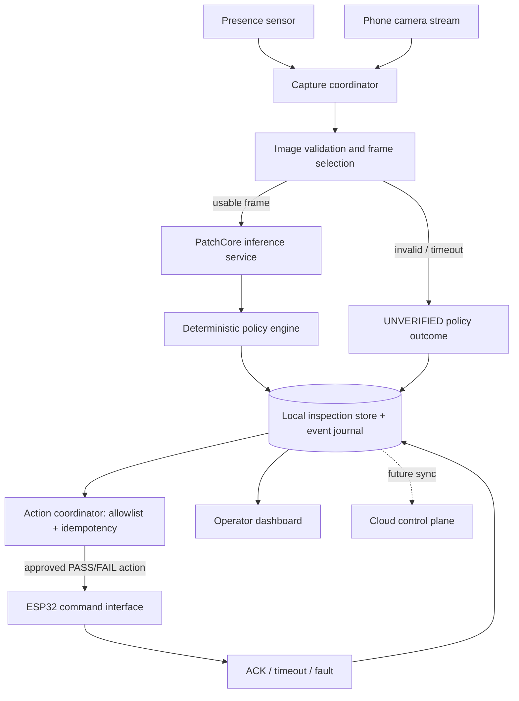

# Document 03 — Repository Audit & Software Architecture

**Project:** Agentic AI Smart Manufacturing Quality Inspection & Automation Platform  
**Document version:** 1.0  
**Date:** 15 October 2026  
**Status:** Engineering planning document — source-code audit pending  
**Depends on:** Production PRD v3.0; Document 01 Project Charter & Execution Roadmap; Document 02 Hardware Design & Bill of Materials

> **Evidence note:** The available project files establish the intended design, not the state of the code. The current Library inventory reviewed for this document contained PRD/design and prototype documents, but no identifiable application source-code repository. Therefore, all implementation status, framework versions, endpoints, database schema, and test coverage must be verified against the actual repository. This document must not be used to claim that unverified components already exist.

## 1. Purpose and outcomes

This document defines how to inspect the current codebase before changing it, how to record evidence from the audit, and what architecture the team should move toward for the physical laptop + phone-camera + ESP32 prototype and the later production platform.

At the end of the repository audit, the team should know:

- What code exists, which branch and commit are under review, and whether the working tree contains uncommitted work.
- Which front-end, API, inference, persistence, firmware, test, and deployment components are real, partial, simulated, absent, or blocked.
- How the existing implementation launches locally and which configuration/secrets it needs, without exposing secret values.
- Which features can be reused, which need repair, and which should be implemented next.
- Whether the chosen PatchCore implementation can reliably return scores and anomaly maps, and how those outputs become a traceable `PASS`, `FAIL`, or `UNVERIFIED` disposition.
- How software decisions are separated from physical action execution and acknowledgement.

**Deliverable from the audit:** a completed findings register, an annotated repository tree, a current-state architecture diagram, a list of reproducible start/test commands, and a prioritized implementation backlog.

## 2. Scope and constraints

### In scope

- Read-only initial audit of repository structure, dependencies, environment configuration, build/test commands, API contracts, persistence, model packaging, camera ingestion, ESP32 integration, deployment setup, and observability.
- A small, testable local prototype architecture that runs inference on the existing laptop/PC and uses the borrowed phone as a camera.
- A future migration path toward edge-first inspection with a separately governed cloud control plane.

### Not in scope

- Claiming that the repository was audited when it has not been supplied or opened.
- Replacing the project stack based on preference before understanding the current code.
- Connecting to a real factory PLC, writing arbitrary registers, or altering certified safety circuits.
- Allowing an LLM to determine the core quality disposition or directly control motor/servo pins.
- Deploying to cloud or installing packages before the read-only audit and baseline are captured.

### Prototype constraints

- Laptop/PC is the first inference host. Cloud access is optional and must not be required for local inspection.
- Phone-camera transport is a selectable adapter (USB webcam mode or local Wi-Fi stream). Choose after testing the available handset and network.
- ESP32 executes narrowly defined commands from the laptop. It does not run PatchCore and is not the source of truth for the quality disposition.
- The first physical workflow stops the belt while capturing and inspecting. Automatic reject is enabled only after basic motion, stop, sensor, and acknowledgement tests pass.
- `UNVERIFIED` must stay distinct from `PASS` and `FAIL`. By default it requests manual review and must not trigger an automatic pass or reject.

## 3. Audit status: what is known versus unknown

| Area | Known from the planning documents | Status that must be verified in source |
|---|---|---|
| Product workflow | Evidence-backed inspection; deterministic `PASS` / `FAIL` / `UNVERIFIED`; audit record | Existing state machine, reason-code implementation, retries, and persistence |
| Vision model | PatchCore context with WideResNet50-2, layer2/layer3 features, memory bank, nearest-neighbour patch distances, and smoothed heatmap was previously described | Actual code, dependencies, weight files, preprocessing, memory-bank generation, score direction, threshold config, inference tests |
| Data | Local evidence and durable event journaling are required; cloud synchronization is a later production capability | Current DB/files, migrations, transaction handling, duplicate protection, backups |
| UI/API | A prior stack idea mentioned a web frontend and a Node/Express API plus Python inference service | Actual framework, entry points, API shape, authentication, error handling, contract tests |
| Camera | Phone camera is the initial camera source | Working stream method, frame rate/resolution, disconnect behavior, image-quality checks |
| Electronics | ESP32, presence sensor, indicator LEDs, motor-driver interface, and reject servo are planned | Firmware, protocol, wiring/pin definitions, physical test state, watchdog/reconnect behavior |
| Deployment | Initial local execution; production target is edge-first with cloud-assisted fleet operations | Compose/systemd scripts, CI, environment config, logs, metrics, update/rollback procedures |
| Test coverage | Repeatable model, integration, hardware-in-loop, failure, and acceptance tests are required | Existing tests and actual pass evidence |

**Rule:** Use one of these evidence states for each feature: `IMPLEMENTED_AND_TESTED`, `IMPLEMENTED_NOT_VERIFIED`, `PARTIALLY_IMPLEMENTED`, `SIMULATED`, `PLANNED`, or `BLOCKED`. “The UI displays it” is not proof the underlying operation works.

## 4. Repository audit procedure

### 4.1 Preserve a baseline first

Run the following in the repository root on Linux. These commands inspect state and should not modify the project.

```bash
git status --short
git branch --show-current
git rev-parse HEAD
git log -5 --oneline --decorate
 git ls-files | sed -n '1,240p'
```

Record the output in the audit notes. Do not discard local changes or switch branches as part of the audit. If the directory is not a Git repository, record that fact and capture the top-level tree instead.

```bash
pwd
find . -maxdepth 3 -type f \
  ! -path './.git/*' \
  ! -path './node_modules/*' \
  ! -path './.venv/*' \
  ! -path './venv/*' \
  | sort | sed -n '1,300p'
```

Do not upload `.env`, API keys, certificates, model/customer data, or private datasets in the audit report. Record only the names of required configuration variables and whether each is present; never copy secret values.

### 4.2 Inventory the codebase

| Audit item | Inspect | Evidence to save | Failure/risk to flag |
|---|---|---|---|
| Root structure | `README`, package manifests, Python project file, firmware folder, deployment folder | Tree and file inventory | No single documented start path; duplicate app roots |
| Frontend | `package.json`, route tree, components, state, build scripts | Framework/version and build result | UI with mock data only; unhandled loading/error states |
| Backend/API | entry point, route registration, schemas, middleware | Endpoint list and sample sanitized responses | Unvalidated payloads; permissive CORS; no timeouts |
| Inference | Python package, model code, model manifest, preprocessing | Reproducible inference command and sample output | Notebook-only path; incompatible dependencies; hidden downloads |
| Data persistence | DB config, migrations, models, evidence storage | Schema/migration inventory | Memory-only records; overwrite of decisions; no deduplication |
| Camera | camera adapter, stream reader, capture route | Camera test results and measured stream properties | UI-only webcam demo; no reconnect/timeout behavior |
| ESP32 | PlatformIO/Arduino project, pins, serial/network protocol | Firmware build output and documented pin map | Motor/servo powered from GPIO; unbounded commands |
| Tests | unit, integration, model, API, frontend, hardware tests | Test commands, totals, results | Tests that mock away critical logic without integration checks |
| Configuration | `.env.example`, config loader, secret manager | Variable names and presence/absence checklist | Secret committed; insecure defaults; config drift |
| Packaging/deploy | Dockerfile, Compose, scripts, CI, service files | Clean install/build/start runbook | Unpinned dependencies; startup order failures |
| Operations | structured logs, metrics, health checks, error queues | Health endpoints and failure examples | Silent model/camera failure; unbounded log/data growth |
| Security | auth, authorization, input limits, dependency scan | Findings and severity | Public unauthenticated control endpoint; unsafe file upload |

### 4.3 Establish reproducible baseline commands

Read the existing README and manifests before running anything. Create a scratch branch or clean worktree only after capturing the current state and coordinating with the owner. Use the project's documented commands first. Avoid upgrading dependencies during the audit.

Record for each command:

- Exact command, working directory, commit hash, OS/runtime version.
- Exit code and duration.
- Expected versus observed output.
- Whether it contacts the internet, downloads weights, touches real hardware, or modifies data.
- Any sanitized error log needed to reproduce the issue.

Minimum checks to attempt where the repository supports them:

1. Install dependencies using the existing lockfile.
2. Build/lint/type-check the frontend and API.
3. Import the Python inference module without triggering hidden network downloads.
4. Run unit tests and report counts, failures, skips, and missing test commands.
5. Run one controlled inference against a known local image if a valid model artifact and dataset sample are available.
6. Start services locally and test health/readiness endpoints.
7. Run a camera test without enabling motor actuation.
8. Compile firmware without connecting the conveyor motor or servo.

Do not treat skipped tests, empty test suites, or a successful compile as end-to-end validation.

### 4.4 Dependency and secret checks

- Identify unpinned or conflicting dependencies and runtime versions.
- Confirm model weights and datasets are versioned or referenced through documented, checksummed artifacts; do not silently download mutable “latest” weights in production.
- Confirm `.env` and credential files are ignored by Git. If a secret was committed, remove it from active code and rotate it; deleting it from the latest commit alone does not invalidate the exposed credential.
- Check upload endpoints for content-type, file-size, decode, and image-dimension limits.
- Review serial and network interfaces so only the authorized local process can issue physical commands.
- Produce a dependency/security report; do not automatically update packages during the initial audit.

## 5. Target architecture for the first working prototype

The architecture should be the simplest version that preserves the production-critical boundaries: deterministic decisions, durable records, bounded automation, and clear failure states. Reuse functioning existing modules where possible.

### 5.1 Component responsibilities

| Component | Prototype responsibility | Design boundary |
|---|---|---|
| Operator UI | Start/stop inspection, show live camera frame, score/heatmap, disposition, reason, device status, review action | UI is not the authority for a verdict; it renders the API result |
| Local application API | Validate requests, create inspection IDs, expose results/health, coordinate dependencies | Must not block the web server while CPU/GPU inference runs |
| Camera adapter | Read USB webcam or configured phone stream, bound buffer, timestamp candidates, report connection state | Camera loss creates a visible error / `UNVERIFIED`, never implicit `PASS` |
| Image-quality/frame-selection worker | Validate decode, dimensions, blur/exposure and capture eligibility; choose a frame according to versioned rules | No product-quality PASS judgement here |
| Python inference service | Load pinned PatchCore artifact, run preprocessing/inference, return score and heatmap plus versions/latency | No direct device-control code in the model process |
| Deterministic policy engine | Validate inference response; apply approved thresholds/reason rules; return `PASS`, `FAIL` or `UNVERIFIED` | No LLM in the verdict path; unknown or invalid output is not PASS |
| Local persistence | Store inspection/attempt, evidence metadata, model/policy version, decision, action status and audit trail | Commit decision durably before scheduling a physical action |
| Action coordinator | Enforce allowlist and idempotency; stop/start conveyor and request one reject action when enabled; track acknowledgement | Commands are separate from decision records; retries must not double-reject |
| ESP32 firmware | Read presence sensor; drive indicator outputs; accept bounded commands; acknowledge or report error | It never interprets a model score or authorizes an action independently |
| Sync adapter (later) | Publish outbox records/evidence to cloud and reconcile acknowledgements | Cloud outage cannot undo a committed local decision |

### 5.2 Proposed prototype data flow



For the first build, stop the conveyor after the presence trigger, capture a stable frame, run inference, persist the result, update the indicators, and resume or wait for manual review according to the prototype policy. Do not run continuous belt motion with a timing-sensitive reject mechanism until object travel time, sensor location, actuator response, and repeatability are measured.

### 5.3 Process boundaries

For a local prototype, avoid unnecessary microservices. A reasonable starting structure—subject to repository audit—is:

- One UI application if a web frontend already exists.
- One application API / orchestration process.
- One Python inference worker/service if the model uses PyTorch and benefits from process isolation.
- One ESP32 firmware project.
- One local database and an evidence directory with configured size/retention controls.

The API should enqueue or dispatch inference work with bounded concurrency and a deadline. The Python service must load model weights once at startup where feasible. A separate service is justified if it already exists, improves reliability, or keeps Python ML dependencies isolated. Do not split every module into a network service without a measured need.

## 6. Decision and state contracts

### 6.1 Canonical disposition rules

- `PASS`: eligible evidence and a valid model response satisfy the released policy and quality threshold.
- `FAIL`: eligible evidence produces a valid model response which violates the released policy threshold/rules.
- `UNVERIFIED`: image/camera/input quality is insufficient; model/artifact is missing or fails; output is malformed; deadline expires; required views disagree; score lies in a configured review band; or the system cannot safely determine a disposition.
- Processing exceptions must include a machine-readable reason code, not only a free-text error.
- A physical action status is not the disposition. A recorded `FAIL` can coexist with `REJECT_ACTION_FAILED` or `REJECT_ACK_TIMEOUT`.

### 6.2 Suggested inspection states

`RECEIVED → CAPTURE_PENDING → CAPTURING → EVIDENCE_VALIDATION → INFERENCE_RUNNING → DECISION_COMMITTED → ACTION_PENDING → ACTION_CONFIRMED → COMPLETED`

Exception branches include `HUMAN_REVIEW`, `UNVERIFIED_RECORDED`, `ACTION_FAILED`, `TIMED_OUT`, and `CANCELLED`. Actual allowed transitions must be formalized in code and persisted. Reinspection creates a linked attempt; it does not erase the original attempt/decision. A retry should reuse the same idempotency key for the same logical operation, or use a new linked attempt identifier when it truly represents a new inspection attempt.

### 6.3 Minimal response contract

```json
{
  "inspection_id": "ins_<stable-id>",
  "attempt_id": "att_<stable-id>",
  "disposition": "UNVERIFIED",
  "workflow_state": "HUMAN_REVIEW",
  "reason_codes": ["IMAGE_QUALITY_BELOW_MINIMUM"],
  "inference": {
    "model_version": "<pinned-model-release>",
    "score": null,
    "score_type": "patchcore_anomaly_score_v1",
    "latency_ms": null,
    "heatmap_ref": null
  },
  "policy_version": "<policy-version>",
  "evidence": [{"asset_id": "ev_<stable-id>", "sha256": "<digest>"}],
  "action": {"status": "NOT_REQUESTED", "acknowledged_at": null},
  "created_at": "<UTC timestamp>",
  "correlation_id": "corr_<stable-id>"
}
```

This is a target example, not a claim about the current API. When inference never ran, score and latency remain null; the platform must not invent measurements.

### 6.4 Suggested local API surface

Final routes must fit the existing application. Candidate contract boundaries for review—not a demand to add all of them—include:

- `GET /health/live` — process is running.
- `GET /health/ready` — required local dependencies are ready; optional cloud service being offline does not necessarily make an edge inspection cell unready.
- `GET /api/v1/system/status` — camera, model, persistence and ESP32 connection status.
- `POST /api/v1/inspections` — create inspection and start the configured workflow.
- `GET /api/v1/inspections/{inspection_id}` — return current/terminal status and trace references.
- `POST /api/v1/inspections/{inspection_id}/review` — accept an authorized, reasoned human resolution as a new audit event.
- `POST /api/v1/actions/{action_id}/ack` — internal adapter path to persist acknowledgement where applicable; protect from browser/public use.

Use request/response schemas, bounded payload size, clear error codes, and an idempotency header/key for creation and action requests. Do not expose a general endpoint that accepts arbitrary GPIO numbers, servo angles, motor duration, or raw serial strings from the browser.

## 7. Model service requirements

The earlier project context describes PatchCore with WideResNet50-2 features from layer2/layer3, a memory bank, nearest-neighbour patch distances, and smoothed anomaly heatmaps. Treat that as the intended baseline to verify—not as verified repository implementation.

Audit and document:

1. Framework/package versions and how the feature extractor and pretrained weights are obtained.
2. Training/reference-image manifest, train/validation/test split, exclusions, category definitions, and data provenance.
3. Exact preprocessing: image decoder, color channels, size, crop/resize/interpolation, normalization and any masks.
4. Feature layers and tensor dimensions, memory-bank creation/sampling, nearest-neighbour calculation, score aggregation and heatmap smoothing.
5. Score orientation (larger means more anomalous or the reverse), category/site-specific thresholds, threshold source/version, and near-threshold handling.
6. Artifact manifest with code digest, model weights digest, dependency lock digest, preprocessing version, training data version, and validation report.
7. Warm/cold load time, CPU/GPU memory, latency p50/p95, failure modes and behaviour when model files are absent.
8. Good-part and defective-part evaluation using a frozen held-out set. MVTec AD is a useful baseline but does not replace validation on the chosen physical object and camera/lighting setup.

The product category remains undecided until the available model/data is reviewed. Do not hard-code product labels, defect labels, threshold values, or acceptance rates before that review.

## 8. Local persistence and evidence

For a small offline-first prototype, SQLite may be considered if its concurrent-write and recovery requirements suit the existing application; if a database already exists and is reliable, audit it first. PostgreSQL or a managed relational database is a production deployment decision, not automatically required for the first bench build.

Minimum local record groups:

- `inspection` and `inspection_attempt` — stable IDs, timestamps, status, input source, part/trigger correlation.
- `evidence_asset` — file path/object key, SHA-256, type, dimensions, capture timestamp and retention state.
- `inference_result` — model release, score definition/value, latency and output metadata.
- `quality_decision` — final disposition, reason codes, policy version and supersession link.
- `action_execution` — typed action, idempotency key, status, request/ack timestamps, timeout/failure reason and feedback if available.
- `audit_event` — actor, action, before/after context, reason and correlation ID.
- `outbox_event` — durable retryable event record for future sync.

Write the quality decision and associated outbox event in one transaction where the selected store supports it. Store large images/heatmaps as files or object assets, not database blobs by default; validate paths, compute a digest, and avoid accepting arbitrary filesystem paths from clients. Define evidence quotas and disk-pressure warnings before repeated live runs.

## 9. ESP32 protocol boundary

Treat the ESP32 link as a constrained actuator interface. Select USB serial or authenticated local Wi-Fi only after the existing firmware and laptop networking are reviewed. The protocol must be versioned and schema-validated.

Example conceptual command (not final wire format):

```json
{
  "protocol_version": 1,
  "command_id": "cmd_<stable-id>",
  "inspection_id": "ins_<stable-id>",
  "action": "SET_INDICATOR",
  "value": "AMBER",
  "expires_after_ms": 1500
}
```

Required protocol properties:

- Enumerated actions only: for example `SET_INDICATOR`, `STOP_BELT`, `RESUME_BELT`, `REQUEST_REJECT`, `HEARTBEAT`.
- Command ID, correlation/inspection ID, monotonic sequence or idempotency token, protocol version, bounded expiry and explicit acknowledgement.
- Reject malformed, expired, out-of-range, duplicated, or unknown commands; return a machine-readable error code.
- Acknowledge receipt separately from physical completion. Physical completion is recorded only if the selected feedback method supports it.
- On lost connection, watchdog expiry, or invalid state: stop automatic sequence progression, set a safe visible state, and require a defined recovery path. A software stop command is not a substitute for a physical power disconnect.
- Motor/servo current must come from properly rated external supplies and drivers. Do not power either directly from ESP32 GPIO. Keep grounds/reference and isolation design consistent with the chosen hardware; confirm wiring against final part datasheets.
- Prototype remains supervised, low-voltage, tabletop-only; no factory PLC or safety-loop connection.

## 10. Security and reliability baseline

P0 (before a supervised physical trial):

- No secrets in Git or logs; local service binds only to intended interfaces.
- Request validation and size/time limits on uploads and inference jobs.
- Explicit action allowlist, command authentication/protection appropriate to the chosen transport, and idempotency.
- Local durable result before a reject request; timeout/error becomes visible and never silently converts a `FAIL` into `PASS`.
- Physical belt power disconnect accessible; motor wiring covered/secured; moving rollers and reject arm kept clear of fingers.
- Manual review path for `UNVERIFIED`; camera/model/ESP32 disconnected tests.
- Structured logs with correlation IDs and no image bytes, credentials or unnecessary personal data.

P1 (before a production pilot):

- Role-based access, protected device identity/certificate lifecycle, tenant isolation, encrypted evidence handling and configurable retention.
- Signed/versioned model and firmware releases, deployment rollback, tested backup/restore, durable sync outbox and dead-letter remediation.
- Health/readiness, camera/model/edge-device metrics, disk/backlog thresholds, actionable alerts and documented incident runbooks.
- Threat model, security review, dependency scanning, vulnerability remediation plan and site-specific industrial integration approval.

## 11. Test strategy and completion gates

| Test layer | Minimum evidence | Gate |
|---|---|---|
| Unit | State transitions, policy thresholds, reason-code mapping, duplicate protection, schema validation | Deterministic tests pass in CI/local command |
| Model | Valid input/output, missing/corrupt artifact, preprocessing consistency, frozen evaluation set, heatmap shape | Reproducible result report; failures map to explicit error/UNVERIFIED policy |
| API integration | Request validation, timeout, unauthorized action, concurrent inspection, DB rollback | Contract tests pass; no duplicate committed action |
| Camera | Startup, stream loss/reconnect, low light/blur, stale frames, oversized image | Invalid/missing frame never yields PASS |
| Persistence | Restart recovery, duplicate event replay, disk nearly full, incomplete evidence write | Committed decisions survive process restart; no silent record loss |
| Firmware/protocol | Malformed, duplicate, expired command; disconnected host; watchdog; acknowledgement timeout | Unsafe/unknown command is refused; no surprise motor activation |
| Hardware-in-loop | Sensor trigger to stopped belt, indicator state, exactly-one reject request/action, manual stop | Supervised low-voltage test passes with repeatable measurements |
| End-to-end | Known good, known defective, ambiguous/poor evidence, camera loss, model failure, ESP32 loss | Correct disposition and traceable outcome for every scenario |

Acceptance conditions for the first prototype:

1. One real captured frame can be linked to a persisted inspection record and model/policy version.
2. Good, defective, and ambiguous inputs produce the expected outcomes for the chosen dataset/object; do not count demo images as validated industrial performance.
3. The app distinguishes inference failure from a legitimate anomaly score.
4. `PASS` updates green; `FAIL` updates red and sends at most one explicitly authorized reject request; `UNVERIFIED` updates amber and opens manual review.
5. The belt is stopped during capture/inference in the first workflow.
6. Replayed requests and duplicate triggers do not duplicate a committed decision or physical reject.
7. Restarting the app preserves previous decisions and action status.
8. The local workflow remains usable without cloud/network connectivity, except for the camera link itself if that camera method depends on the network.

## 12. Repository audit register (fill during inspection)

| ID | Finding | Evidence / path / command | Status | Severity | Owner / next action |
|---|---|---|---|---|---|
| RA-01 | Repository root, branch and commit identified | Pending | `BLOCKED` until repo supplied | High | Capture `git status`, branch and commit |
| RA-02 | Frontend build and start command reproducible | Pending | `PLANNED` | High | Confirm package/entry points and run build |
| RA-03 | API build/start and route inventory reproduced | Pending | `PLANNED` | High | Record route schemas and health endpoints |
| RA-04 | PatchCore inference path and artifact manifest verified | Pending | `PLANNED` | Critical | Trace code and run controlled inference |
| RA-05 | Decision policy uses only validated outputs | Pending | `PLANNED` | Critical | Add/verify policy unit tests |
| RA-06 | Decision persistence and idempotency verified | Pending | `PLANNED` | Critical | Inspect transactions and replay tests |
| RA-07 | Camera stream works and handles disconnect safely | Pending | `PLANNED` | High | Test camera adapter without actuation |
| RA-08 | ESP32 command allowlist and acknowledgements verified | Pending | `PLANNED` | Critical | Inspect firmware/protocol; keep motor disconnected |
| RA-09 | Secrets/configuration handled safely | Pending | `PLANNED` | Critical | Review ignore rules and variable names only |
| RA-10 | CI/tests and local runbook reproducible | Pending | `PLANNED` | High | Run existing checks, record results |

Do not change `Pending` to `Implemented` based on code presence alone; attach repeatable evidence.

## 13. Priority backlog after audit

Order of work should be driven by the findings, but the default sequence is:

1. **P0 — Establish baseline:** repository tree, commit, runtime versions, clean run/build, dependency inventory, secret scan and README accuracy.
2. **P0 — Prove AI path:** load an existing model artifact without hidden downloads; inference on a local image; capture score and heatmap; record versions and timing.
3. **P0 — Prove deterministic decision path:** schema validation, score interpretation, threshold versioning, `PASS` / `FAIL` / `UNVERIFIED`, reason codes and unit tests.
4. **P0 — Persist traceability:** stable inspection IDs, evidence hashes, linked attempts, durable decision and idempotency tests.
5. **P0 — Camera integration:** select USB or phone-stream adapter; document exact setup and reconnect behaviour; still no automatic physical actuation.
6. **P0 — Firmware interface:** define protocol and hardware pin map; first validate LEDs and sensor, then belt stop/start under supervision, then servo reject.
7. **P0 — Hardware-in-loop workflow:** verify stop-during-inspection, explicit action acknowledgements, exactly-once semantics, physical kill/disconnect and recovery.
8. **P1 — Operational hardening:** structured logs, local storage alarms, backup/restore, packaging, update/rollback and support runbook.
9. **P1 — Production evolution:** edge/cloud split, device identity, durable sync outbox, tenant controls, release governance and site acceptance plan.

## 14. Artifacts to deliver at the end of the repository audit

- [ ] Sanitized repository inventory and branch/commit record.
- [ ] Current-state component/data-flow diagram.
- [ ] Verified local setup/start/test commands with versions and test results.
- [ ] Feature status matrix using the six evidence states.
- [ ] API endpoint and event-contract inventory.
- [ ] Model artifact/preprocessing/threshold manifest and reproducible sample inference.
- [ ] Data schema/migration and evidence-retention review.
- [ ] Camera method and ESP32 protocol/pin map findings.
- [ ] Risk register with severity, evidence, owner and remediation.
- [ ] Prioritized, estimable backlog with acceptance tests.

## 15. What is needed to turn this plan into a real audit

Provide the actual repository as a ZIP or share the repository link and the specific branch/commit to review. If it is a private remote that cannot be accessed here, upload a source ZIP with `.env`, keys, certificates, private datasets and customer records excluded. Include the model manifest/weight filenames and `README` if those are stored separately.

Until that source is available, the architecture and checklists in this document are the planning baseline. No repository feature is marked as verified.

---

**Next document:** Document 04 — Dataset & AI Model Qualification, including data inventory, leakage-safe splits, PatchCore reproduction, threshold selection, benchmark reporting, and acceptance criteria for the selected physical test object.
