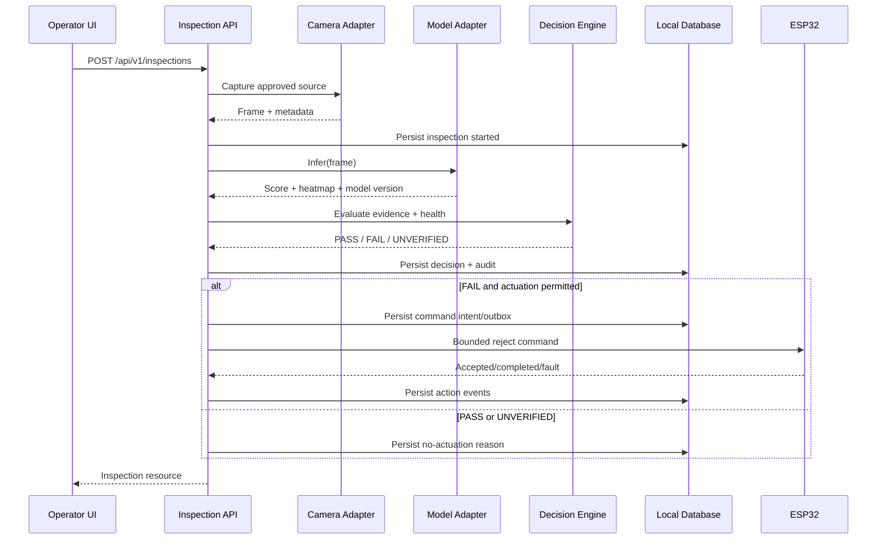

# Document 07 — Inspection API & Decision Engine
**Project:** Agentic AI Smart Manufacturing Quality Inspection & Automation Platform  
**Document type:** Engineering specification  
**Status:** Proposed design — implementation and repository details must be verified  
**Version:** 1.0

## 1. Purpose

Define the laptop-side application contract that turns a camera observation into a traceable quality decision and, only when permitted, a bounded command to the ESP32 prototype.

This document specifies a target design. It does **not** assert that these endpoints, database tables, or workflows already exist in the current codebase. Confirm the repository, runtime, framework, and existing schemas before implementation.

## 2. Design principles

1. **Local-first:** inspection and actuation must work without cloud connectivity.
2. **Deterministic decisions:** the model produces evidence; a versioned policy converts evidence into PASS, FAIL, or UNVERIFIED.
3. **Fail closed:** missing frames, model errors, stale results, invalid calibration, or uncertain scores produce UNVERIFIED, not an assumed PASS.
4. **Decision/action separation:** a FAIL decision is not proof that the physical item was rejected.
5. **Durability before actuation:** persist the inspection decision and an actuator-command intent before transmitting a reject command.
6. **Bounded control:** the laptop sends only documented, bounded commands; the ESP32 independently validates interlocks and command ranges.
7. **Idempotency:** retries must not cause duplicate reject cycles.
8. **Auditability:** retain model/policy versions, timestamps, outcomes, command acknowledgements, manual resolutions, and faults.
9. **Human review:** UNVERIFIED items are routed to manual review by default.
10. **No direct LLM control:** an LLM may help summarize or explain records, but it must not choose GPIO values or bypass the deterministic decision policy.

## 3. Proposed service boundaries

- **Camera adapter:** obtains a frame from the selected camera and attaches capture metadata.
- **Frame validator:** checks that the frame exists, decodes, meets configured dimensions/format, is not stale, and is within size limits.
- **Model adapter:** calls the qualified model and normalizes its output. It does not make the final quality decision.
- **Decision engine:** applies the active, versioned policy to normalized model evidence and system-health checks.
- **Inspection service:** coordinates a single inspection and persists its state transitions.
- **Persistence layer:** stores inspection, model/policy references, actuator commands, action events, and audit events.
- **Actuator adapter:** translates an authorized action intent into the bounded serial protocol specified in Document 06.
- **Operator UI:** displays evidence, decision, action state, and manual-review controls.
- **Health/readiness service:** exposes service status without revealing secrets or unnecessary system details.

The actual language/framework should be chosen after the repository audit. Keep model inference isolated behind an adapter so that model implementation can change without changing the API contract.

## 4. End-to-end inspection flow

1. Validate request and optional idempotency key.
2. Capture a frame from an approved camera source, or accept a short-lived server-issued frame reference. Avoid accepting arbitrary client-supplied filesystem paths.
3. Validate frame dimensions, decoding, freshness, and configured camera identity.
4. Create a durable inspection record with status `RECEIVED`/`PROCESSING`.
5. Run model inference and record the model artifact/version and raw output.
6. Validate model output: finite score, expected shape, supported class/category, and compatible preprocessing/model version.
7. Apply the versioned deterministic decision policy.
8. Persist the decision and its evidence. If the result is `UNVERIFIED`, route to manual review and do not issue an automatic reject command by default.
9. For `FAIL`, create a durable actuator-command intent only if the line is enabled, the actuator is ready, and the policy permits the action.
10. Transmit the bounded command using Document 06’s serial protocol. Record acknowledgement and completion/fault separately.
11. Return inspection result immediately or asynchronously according to implementation, and expose the action state through the inspection resource.
12. Emit an audit event for material state changes.

### Sequence diagram



## 5. HTTP API proposal

Base path: `/api/v1`. Use JSON request/response bodies, UTC timestamps in ISO 8601 format, and a consistent error envelope. These are proposed contracts, not verified existing routes.

### 5.1 `GET /api/v1/health`

Purpose: process liveness only. A successful response means the API process can answer requests; it does not prove that the model or camera is ready.

Example:
```json
{
  "status": "ok",
  "service": "inspection-api",
  "timestamp": "2026-10-15T10:00:00Z"
}
```

Do not include secrets, absolute paths, serial device identifiers, or sensitive environment details.

### 5.2 `GET /api/v1/readiness`

Purpose: determine whether a new inspection can safely run. Return an explicit component status and overall readiness.

Example:
```json
{
  "ready": false,
  "components": {
    "camera": "not_ready",
    "model": "ready",
    "database": "ready",
    "actuator": "not_ready"
  },
  "reasons": ["camera_not_connected"]
}
```

Readiness for inspection and readiness for actuation should be separately represented. A camera/model may be ready while the actuator is disabled.

### 5.3 `POST /api/v1/inspections`

Purpose: create an inspection. Preferred first-version request asks the server to capture from a configured camera; it should not trust arbitrary filesystem paths from clients.

Request:
```json
{
  "camera_id": "primary",
  "product_reference": "optional-batch-or-item-reference",
  "mode": "automatic",
  "idempotency_key": "client-generated-unique-key"
}
```

Fields:
- `camera_id` (required): configured camera identifier, not a path or shell command.
- `product_reference` (optional): non-sensitive operator or batch reference.
- `mode` (optional): `automatic` or `review_only`. `review_only` never actuates.
- `idempotency_key` (recommended): unique within a documented scope and retention window.

Response for synchronous completion:
```json
{
  "inspection_id": "ins_01J...",
  "status": "DECIDED",
  "decision": {
    "outcome": "UNVERIFIED",
    "reason_codes": ["MODEL_SCORE_IN_REVIEW_BAND"],
    "policy_version": "quality-policy-1"
  },
  "action": {
    "status": "NOT_REQUESTED",
    "reason": "manual_review_required"
  },
  "created_at": "2026-10-15T10:00:00Z"
}
```

For long-running inference, return `202 Accepted` with `inspection_id` and a resource URL; the client polls `GET /api/v1/inspections/{inspection_id}`. Do not mix synchronous and asynchronous semantics unpredictably; choose one contract for the first implementation.

### 5.4 `GET /api/v1/inspections/{inspection_id}`

Return the current durable inspection resource, including:
- inspection ID and lifecycle status;
- capture metadata and frame reference/hash (not necessarily raw image bytes);
- model artifact/version and normalized output;
- decision outcome, reason codes, threshold/policy version;
- action status, command ID, acknowledgement/completion/fault;
- timestamps and manual-resolution state.

Access to raw images and detailed heatmaps should be separately controlled if the application is network-accessible.

### 5.5 `GET /api/v1/inspections`

Paginated inspection history. Proposed query parameters: `limit` (bounded, e.g. 1–100), `cursor`, `outcome`, `from`, `to`, and `camera_id`. Validate filters and avoid unbounded queries.

### 5.6 `POST /api/v1/inspections/{inspection_id}/manual-resolution`

Purpose: authorized operator records a review outcome for an UNVERIFIED or otherwise review-required item.

Request:
```json
{
  "resolution": "ACCEPTED_BY_REVIEWER",
  "reason": "Visual review completed",
  "operator_id": "operator-identifier",
  "expected_record_version": 3
}
```

Require authentication/authorization if reachable beyond a trusted local UI, a reason, optimistic concurrency (`expected_record_version` or equivalent), and an audit record. Manual resolution must not rewrite the original model output or erase the initial decision. Any physical action after review must be a separate explicit operation with a fresh interlock check.

### 5.7 `GET /api/v1/metrics`

Internal/admin-only operational metrics: inspection counts by outcome, inference latency, camera failures, UNVERIFIED rate, actuator acknowledgement/completion/fault rates, and queue depth. Do not expose sensitive paths, raw images, or personal information.

### 5.8 Decision mutation endpoint

Do **not** expose a general endpoint that lets clients submit arbitrary model scores or set PASS/FAIL. The server must derive decisions from a trusted model result and the active policy. If an internal test endpoint is needed, keep it disabled in production and explicitly marked unsafe.

## 6. Canonical schemas

The following are conceptual schemas; map them to the language and validation library used by the actual repository.

### 6.1 Inspection resource
```json
{
  "inspection_id": "string",
  "status": "RECEIVED | PROCESSING | DECIDED | ACTION_PENDING | ACTION_IN_PROGRESS | COMPLETED | FAULTED | CANCELLED",
  "camera_id": "string",
  "capture": {
    "captured_at": "ISO-8601 timestamp",
    "width": 0,
    "height": 0,
    "format": "jpeg",
    "frame_sha256": "hex digest"
  },
  "model": {
    "artifact_id": "string",
    "version": "string",
    "score_name": "string",
    "score": 0.0,
    "score_semantics": "anomaly_score_not_probability",
    "heatmap_reference": "optional-safe-reference"
  },
  "decision": {
    "outcome": "PASS | FAIL | UNVERIFIED",
    "reason_codes": ["string"],
    "policy_version": "string",
    "decided_at": "ISO-8601 timestamp"
  },
  "action": {
    "status": "NOT_REQUESTED | PENDING | ACCEPTED | IN_PROGRESS | COMPLETED | FAILED | UNKNOWN",
    "command_id": "optional-string",
    "fault_code": "optional-string"
  }
}
```

Never report an absent model score as zero. Represent unavailable evidence as missing/null with an explicit reason and normally produce UNVERIFIED.

### 6.2 Normalized model result
Required fields: `artifact_id`, `model_version`, `preprocessing_version`, `score_name`, finite numeric `score`, score direction (e.g. higher means more anomalous), optional heatmap reference, inference duration, and validation status. The model adapter must declare score semantics; a score is not a calibrated probability unless calibration evidence explicitly establishes that.

### 6.3 Decision result
Required fields: `outcome`, `reason_codes`, `policy_version`, `model_version`, `threshold_config_version`, and `decided_at`. Include relevant score and thresholds for auditability, but do not treat them as a substitute for model validation.

### 6.4 Error envelope
```json
{
  "error": {
    "code": "CAMERA_UNAVAILABLE",
    "message": "Inspection could not be completed.",
    "retryable": true,
    "request_id": "req_01J...",
    "details": {}
  }
}
```

Use stable machine-readable error codes and safe user-facing messages. Avoid returning stack traces, credentials, arbitrary filesystem paths, or raw exception strings.

### 6.5 ESP32 command and acknowledgements

Use the bounded serial message format from Document 06 as the source of truth. At the application layer, track a `command_id`, `inspection_id`, action type, deadline, and state. An acknowledgement such as `ACCEPTED` means only that the firmware accepted the command; it does not mean the reject flap completed its movement or that the item was physically diverted. Record `COMPLETED`, `FAULT`, or `UNKNOWN` separately where supported.

## 7. Deterministic decision policy

### 7.1 Outcome semantics
- **PASS:** all required checks succeeded and the model evidence is within the qualified acceptance region.
- **FAIL:** all required checks succeeded and the model evidence is within the qualified reject region.
- **UNVERIFIED:** any required check failed, evidence is missing/stale/invalid, model output is out of distribution or not qualified, the score is in a review band, or system health is insufficient.

### 7.2 Thresholds
For a model where larger scores mean greater anomaly, a proposed three-band policy is:
- `score <= pass_threshold` → candidate PASS;
- `score >= fail_threshold` → candidate FAIL;
- otherwise → UNVERIFIED.

This is a policy pattern, not a calibrated numeric configuration. Thresholds must be selected from the actual dataset and locked validation procedure. Require `pass_threshold < fail_threshold`. Store policy versions immutably; changing thresholds creates a new version and requires requalification. If score direction differs, normalize it in the model adapter or define explicit policy direction.

### 7.3 Mandatory UNVERIFIED conditions
- frame capture/decode failure, stale frame, wrong dimensions, or unsupported format;
- model unavailable, timeout, non-finite score, malformed heatmap/output, incompatible artifact/preprocessing version;
- no valid threshold policy, unknown category, or expired qualification;
- camera/model health check failure;
- inference result is associated with a different frame/request;
- system state is ambiguous after a crash or an actuator command has unknown status.

### 7.4 Actuation policy
- PASS: no reject action.
- FAIL: one bounded reject request only if automatic mode is enabled, item timing/tracking is valid, actuator is ready, and all firmware interlocks permit it.
- UNVERIFIED: manual review by default; no automatic accept/reject.
- `review_only` mode: never actuates.
- If a command’s completion status is unknown, do not blindly retry the physical action. Enter a recoverable fault/reconciliation state and require sensor evidence or operator confirmation.

## 8. Persistence model

Choose the database after inspecting the repository and expected concurrency. SQLite may be adequate for a single laptop process and local prototype; a server database may be warranted for concurrent operators or multi-machine deployment. Do not assume either is already configured.

### 8.1 Proposed entities
- `inspections`: ID, lifecycle status, camera ID, capture timestamp, frame hash/reference, product/batch reference, creation/update timestamps.
- `model_artifacts`: immutable artifact ID, file/hash reference, model/preprocessing version, category, qualification status, metadata.
- `model_results`: inspection ID, score name/value/direction, heatmap reference, inference duration, validation flags.
- `decision_policies`: immutable policy version, thresholds, score semantics, qualification record, effective timestamp.
- `decisions`: inspection ID, outcome, reason codes, policy version, decision timestamp.
- `actuator_commands`: command ID, inspection ID, action type, idempotency key, status, deadline, attempt count, timestamps.
- `actuator_events`: command ID, event type (`SENT`, `ACCEPTED`, `STARTED`, `COMPLETED`, `FAULT`, `UNKNOWN`), firmware correlation ID, timestamp, safe payload.
- `audit_events`: actor, event type, entity ID, timestamp, reason, request ID, safe structured details.
- `camera_events`: camera ID, status transitions, capture failures, timestamps.
- Optional `manual_resolutions`: inspection ID, reviewer ID, resolution, reason, expected version, timestamp.

Define foreign keys, unique constraints, indexes on timestamps/outcomes/status, retention policy, and migrations. Raw images and heatmaps should have an explicit retention policy and should not be embedded in every database row.

## 9. Reliability and idempotency

### 9.1 Request idempotency
- Client sends `Idempotency-Key` header or request field.
- Persist the key, scope, and request hash with the created inspection.
- Same key + same request returns the original resource; same key + different request returns `409 IDEMPOTENCY_KEY_REUSED`.
- Define retention duration and ensure it exceeds typical retry/recovery windows.

### 9.2 Command outbox
Within a single database transaction:
1. persist decision;
2. persist an actuator-command intent/outbox record;
3. commit.

A dispatcher sends pending commands and records all acknowledgements. This prevents a crash between recording the decision and recording intent from silently losing an action. Do not keep a database transaction open while waiting on serial I/O.

### 9.3 Crash recovery
- `PROCESSING` records older than a configured lease timeout are marked interrupted and reconciled.
- Never silently rerun an inspection against a new frame and reuse the old inspection ID.
- A command with no definitive completion is `UNKNOWN`, not `COMPLETED`.
- Do not auto-replay non-idempotent physical commands after ambiguous delivery.
- Provide an operator-visible recovery screen and audit all recovery decisions.

### 9.4 Duplicate item/reject prevention
Where physical line tracking exists, associate each item with a unique item/trigger ID and reject window. The first prototype may not have enough sensors to confirm item identity or physical diversion. If so, explicitly report that physical rejection is unverified; do not claim closed-loop sorting accuracy.

## 10. Security and operational controls

- Bind to `127.0.0.1` by default. Expose on LAN only when explicitly configured.
- If LAN access is enabled, require authentication, role-based permissions, and TLS where practical; do not rely on CORS as authentication.
- Validate all JSON fields, lengths, enums, timestamps, IDs, numeric ranges, and request sizes.
- Do not accept shell commands, arbitrary model paths, arbitrary filesystem paths, or unrestricted serial commands through public endpoints.
- Use an allowlist for camera IDs and model artifacts.
- Restrict manual resolution and maintenance commands.
- Redact secrets and sensitive file paths from logs.
- Rate-limit expensive inspection requests and bound concurrency/queues.
- Use safe image decoding and resource limits.
- Record software, model, policy, and firmware versions for each inspection.
- Provide a clear manual actuator-disable state and physical power disconnect. API health does not substitute for physical safety controls.

## 11. Observability

Record structured events with `timestamp`, `request_id`, `inspection_id`, component, event code, duration, and severity. Useful metrics:
- capture success/failure and capture-to-inference latency;
- inference latency and model exceptions;
- outcome distribution and UNVERIFIED rate;
- time spent in each lifecycle state;
- serial send/ack/completion/fault counts;
- command latency, timeout and unknown-status counts;
- queue depth, database write failures and disk space warnings.

Do not log every raw frame by default. Add rotation, storage limits, and a retention plan.

## 12. Testing strategy

### Unit tests
- thresholds at exact boundaries and just above/below;
- invalid policy (`pass_threshold >= fail_threshold`);
- NaN/Infinity/missing model score;
- stale frame and incompatible model/preprocessing versions;
- all decision reason codes;
- idempotency key collision and request-hash mismatch.

### API contract tests
- valid/invalid request schemas;
- status codes and error envelopes;
- pagination bounds;
- authorization for manual resolution/metrics;
- no arbitrary path or command acceptance.

### Integration tests
- camera adapter failure;
- model timeout and malformed output;
- database unavailable/disk full;
- serial disconnected, invalid acknowledgement, delayed acknowledgement;
- ESP32 `ACCEPTED` followed by `FAULT`;
- duplicate HTTP retry returns same inspection;
- process restart with pending outbox record;
- process restart with command status unknown;
- manual resolution concurrency conflict.

### Hardware-in-the-loop tests
Use a safe dummy load or disconnected actuator first. Then test low-voltage hardware with the motor mechanically unloaded and the reject mechanism guarded. Confirm physical stop/power disconnect works independently. Validate only one reject cycle per inspection, no motor/servo power through ESP32 pins, and safe recovery from serial disconnect.

### Acceptance criteria
- Every inspection has a unique durable ID and traceable model/policy versions.
- Invalid or missing evidence never becomes PASS.
- PASS, FAIL, and UNVERIFIED are visually and programmatically distinct.
- Quality decision and actuator status are separate fields and records.
- Retrying the same idempotent request does not create duplicate inspections or reject commands.
- Ambiguous physical action status is shown as UNKNOWN and does not auto-replay.
- A disconnected ESP32 cannot cause an inspection to be falsely reported as physically rejected.
- Application runs locally without cloud access.
- Operator manual resolution is authenticated when required and always audited.

## 13. Implementation order

1. Inspect repository and identify framework, existing APIs, model interface, and persistence.
2. Define typed schemas and stable error codes.
3. Implement decision engine as a pure, unit-tested module.
4. Implement local persistence and migrations.
5. Implement health/readiness and inspection resource endpoints.
6. Add camera/model adapters with timeouts and normalized result validation.
7. Add inspection orchestration and idempotency.
8. Add durable command outbox and ESP32 serial adapter.
9. Add operator history/manual review and audit log.
10. Run contract/integration/HIL tests before enabling automatic actuation.

## 14. Open questions that require evidence

- Which web/API framework and runtime does the actual repository use?
- What database, if any, is already present?
- Does inference currently run in-process or in a separate service?
- What exactly does the model score represent and which direction indicates anomaly?
- Can the physical line reliably identify the item currently at the reject point?
- Which ESP32 board, serial protocol implementation, sensor wiring, and motor driver are confirmed?
- Is the UI intended to run only on the laptop or be reachable from other devices?

Until these are answered from the real repo and hardware, this document remains the target API/decision design, not evidence of a completed implementation.
