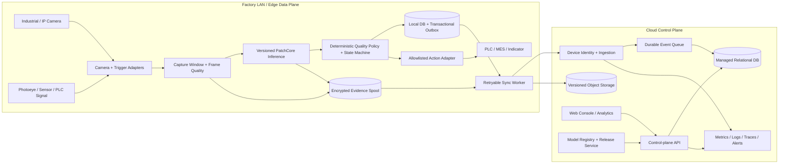

# Product Requirements Document

# Agentic AI-Powered Smart Manufacturing Quality Inspection & Automation Platform

**Document version:** 3.0 — Production Target State  
**Prepared:** 15 October 2026  
**Status:** Engineering planning baseline; requires repository audit and site discovery before implementation commitments  
**Audience:** Product, engineering, ML, platform/SRE, cybersecurity, industrial automation, quality engineering, operations, and customer implementation teams

---

## Document control and interpretation

This PRD consolidates the original product definition, the Agentic AI PRD upgrade, and the research report into one production-oriented specification. It is intended to guide a real engineering team from codebase audit through controlled factory pilot and general availability (GA).

**Evidence labels used throughout**

- **Existing design context:** described in the previously supplied PRD(s), but not proof that a feature is implemented or tested.
- **Research-backed recommendation:** design direction informed by the research report and public technical references listed at the end.
- **Assumption / to validate:** a proposed default that needs confirmation from the repository, target hardware, site conditions, product, or customer.
- **Acceptance gate:** a measurable condition that must pass before release or operational use.

This task did not audit a live source-code repository, deploy infrastructure, connect to a factory PLC, or independently reproduce benchmark results. Accordingly, no requirement below should be read as evidence that it is already implemented. Before external release, the engineering team must mark every requirement as `IMPLEMENTED_AND_TESTED`, `IMPLEMENTED_NOT_VERIFIED`, `PARTIALLY_IMPLEMENTED`, `SIMULATED`, `PLANNED`, or `BLOCKED` based on code inspection and repeatable tests.

## Executive decision

Build a **factory-resilient quality operations product**, not an AI demo. The platform must capture evidence, run vision inference, make an auditable quality disposition, route exceptions to people, execute only explicitly authorized actions, confirm whether actions occurred, preserve records through network outages, and provide administrators with a secure multi-site control plane.

The recommended baseline is **edge-first for time-critical inspection, cloud-assisted for fleet and business operations**:

1. Camera capture, frame selection, PatchCore inference, deterministic disposition, deduplication, action sequencing, and local evidence journaling run on the factory network.
2. The cloud manages tenants, users, sites, lines, devices, configurations, model release metadata, fleet health, reporting, analytics, integrations, and centrally governed audit records.
3. An encrypted, durable edge outbox synchronizes events and allowed evidence to the cloud when connectivity returns. A cloud outage must not erase or rewrite a quality decision already committed locally.
4. Agentic orchestration is built around typed tools, explicit state transitions, policies, budgets, and audit events. The core PASS / FAIL / UNVERIFIED decision path must not require an LLM or an internet connection.
5. Physical actuation is governed by industrial integration rules, a customer-approved action allowlist, and the site's existing PLC/safety system. An LLM must never directly write arbitrary PLC registers, bypass interlocks, or replace a safety controller.
6. Production readiness is earned through site-specific acceptance tests, model validation, hardware-in-the-loop tests, fault injection, security review, operational runbooks, and signed pilot approval—not through a successful simulated demo.

### Product outcomes

- Inspect each configured part/inspection opportunity using versioned camera, model, and policy configurations.
- Reduce missed defects and unnecessary rejections, measured on representative held-out data and controlled pilot production.
- Provide complete part/batch/inspection traceability with image and heatmap evidence according to the customer's retention policy.
- Recover safely from unavailable cameras, weak images, model errors, event backlogs, cloud disconnection, and failed downstream actions.
- Support multiple tenants, sites, production lines, cameras, products, models, operators, and integrations without data leakage.
- Turn the inspection result into a verified workflow outcome: recorded, routed, actioned where permitted, and closed with evidence.

## Contents

- [1. Product vision and boundaries](#1-product-vision-and-boundaries)
- [2. Success metrics and measurement plan](#2-success-metrics-and-measurement-plan)
- [3. Product operating model](#3-product-operating-model)
- [4. Inspection domain model and deterministic workflow](#4-inspection-domain-model-and-deterministic-workflow)
- [5. Functional requirements](#5-functional-requirements)
- [6. Data architecture and contracts](#6-data-architecture-and-contracts)
- [7. Industrial integration and safety requirements](#7-industrial-integration-and-safety-requirements)
- [8. Edge runtime, synchronization and fleet lifecycle](#8-edge-runtime-synchronization-and-fleet-lifecycle)
- [9. AI / ML lifecycle and quality governance](#9-ai--ml-lifecycle-and-quality-governance)
- [10. Security, identity, privacy and compliance posture](#10-security-identity-privacy-and-compliance-posture)
- [11. Reliability, observability and incident operations](#11-reliability-observability-and-incident-operations)
- [12. Scalability, capacity planning and cost model](#12-scalability-capacity-planning-and-cost-model)
- [13. User experience requirements](#13-user-experience-requirements)
- [14. Testing and verification strategy](#14-testing-and-verification-strategy)
- [15. Environments, CI/CD and infrastructure operations](#15-environments-cicd-and-infrastructure-operations)
- [16. Product administration, onboarding and commercial operations](#16-product-administration-onboarding-and-commercial-operations)
- [17. Phased delivery roadmap and release gates](#17-phased-delivery-roadmap-and-release-gates)
- [18. GA launch checklist](#18-ga-launch-checklist)
- [19. Risk register](#19-risk-register)
- [20. Requirement traceability and implementation tracker](#20-requirement-traceability-and-implementation-tracker)
- [21. Decisions still required before build commitments](#21-decisions-still-required-before-build-commitments)
- [22. First engineering work sequence](#22-first-engineering-work-sequence)
- [Appendices and source basis](#appendix-a-reason-code-starter-set)

---

# 1. Product vision and boundaries

## 1.1 Vision

Deliver a deployable quality-inspection platform that combines industrial vision, deterministic quality policy, bounded agentic orchestration, human review, and enterprise operations. Its core value is not simply finding anomalies. It is coordinating an evidence-backed inspection and carrying its result through a reliable, traceable workflow.

## 1.2 Problem statement

Manual and fragmented inspection workflows can be inconsistent, difficult to scale, slow to investigate, and weakly connected to downstream manufacturing systems. Standalone visual AI demos often stop at a heatmap or label and leave unresolved the production requirements: trigger timing, ambiguous evidence, part identity, retries, duplicate handling, connectivity loss, integration acknowledgements, operator overrides, model traceability, data retention, and operational ownership.

## 1.3 Product promise

For a configured product and production cell, the platform will:

- Capture one or more candidate images at a configured trigger.
- Assess whether the evidence is suitable for the configured inspection.
- Run a released model and versioned decision policy.
- Produce `PASS`, `FAIL`, or `UNVERIFIED` with traceable evidence and reason codes.
- Execute only permitted, configured workflows and track execution separately from the quality decision.
- Present exceptions for human review, preserving who decided what and when.
- Continue the locally configured inspection workflow during a cloud-network outage, within declared edge capacity and retention limits.
- Synchronize auditable records and approved evidence once connectivity is restored.

## 1.4 Target users and jobs to be done

| Persona | Primary jobs | Required product capability |
|---|---|---|
| Quality Engineer | Define product inspection criteria; validate thresholds; investigate false accepts/rejects; approve model releases | Product/camera/model configuration, benchmark and site validation reports, evidence review, threshold governance |
| Line Operator | Know whether the part is accepted, rejected, or needs attention; resolve exceptions quickly | Large, unambiguous verdict; reason code; visual evidence; queue management; guided recovery |
| Production Supervisor | Keep the line productive while controlling escape risk | Line and cell health, rejection/UNVERIFIED rates, alarms, degraded-mode visibility, shift reports |
| Industrial Automation Engineer | Integrate triggers and controlled actions with PLCs, sensors, MES, and line equipment | Adapter configuration, dry-run, command allowlist, interlock/acknowledgement mapping, hardware-in-loop tests |
| Site Administrator | Operate devices, users, networks, retention and support | Device/site/line management, RBAC, diagnostics, policy rollout, audit export, maintenance workflow |
| Platform Administrator / SRE | Operate the SaaS control plane and fleet | Tenant isolation, deployment and rollback, observability, capacity, backups, incident tooling |
| ML Engineer | Train, evaluate, release, monitor, and roll back models | Dataset lineage, reproducible runs, model registry, shadow/canary release, drift and label feedback |
| Auditor / Customer Admin | Reconstruct how and why an outcome was produced | Immutable versioned records, export, retention policy, actor/action history, access logs |
| Operations/Plant Manager | Quantify quality and production impact | Yield and inspection coverage analytics, trend reports, line comparisons, integration to MES/ERP |

## 1.5 Initial target segment

The first commercially supportable use case is **visual anomaly inspection for a defined product family in a controlled inspection cell**, using industrially suitable lighting and a known camera geometry. Typical candidate industries include general manufacturing, electronics assembly, packaging, automotive suppliers, and consumer products.

Pharmaceutical, food safety, aerospace, medical-device, and other highly regulated applications require separate validation, quality-system controls, and regulatory assessment. Their mention is not a claim of certification or suitability for regulated release.

## 1.6 Product boundaries

**In scope**

- Visual anomaly detection and anomaly localization for configured product families.
- Live camera and uploaded-image inspection workflows.
- Product/part/batch identity and sensor-triggered capture.
- Quality outcome, evidence, human review, audit history, analytics, device management, model lifecycle, fleet management, and integrations.
- Edge runtime, offline persistence, cloud synchronization, secure multi-tenant administration, and operational controls.
- Rule-based or LLM-assisted diagnosis/reporting that cannot override core safety and quality gates.

**Out of scope unless separately approved**

- Replacing a safety PLC, emergency stop, machine guarding, or certified functional-safety system.
- Unsupervised LLM control of a physical production line.
- Guaranteeing zero defects, a fixed customer ROI, or a benchmark score before representative validation.
- Autonomous retraining and automatic production promotion of a model without release gates.
- General-purpose process control unrelated to the configured inspection workflow.
- Treating a simulated sensor, relay, diverter, or PLC response as a real industrial integration.
- Claiming compliance certification simply because design controls are present.

---

# 2. Success metrics and measurement plan

Targets below are proposed engineering gates, not claims about the current implementation or guaranteed factory performance. Each pilot must refine them against takt time, criticality, part geometry, image resolution, camera, lighting, edge hardware, and the cost of false acceptance versus false rejection.

## 2.1 Product metrics

| Metric | Initial target / definition | Measurement source |
|---|---|---|
| Inspection coverage | At least 99.5% of eligible, identified inspection opportunities end in a terminal disposition or an explicit exception record; site-specific target may be higher | Trigger counter compared with persisted inspection records |
| Decision traceability | 100% of terminal dispositions reference immutable model, policy, camera/configuration, and evidence metadata | Automated database and event assertions |
| Duplicate protection | No duplicate committed terminal decision or physical action for the same idempotency key | Replay/duplicate integration tests and action ledger |
| UNVERIFIED visibility | 100% of UNVERIFIED cases enter a visible queue or explicit configured exception workflow | Workflow test and operator console |
| Action accountability | Every requested action has a separate execution status and acknowledgement/timeout outcome | Action ledger and integration feedback |
| Cloud-outage continuity | Local inspection continues for at least 72 hours under the site-approved design load, unless local storage limits or a safety/site policy requires a controlled degraded state | Extended disconnection and spool-capacity test |
| Model quality | Meets site-approved lower bound for defect recall and upper bound for false-reject rate on representative, held-out site data | Signed validation report and production sampling |
| Availability | Cloud control-plane monthly SLO target of 99.9% after GA; edge cell availability measured separately and excludes customer power/network/hardware failures unless contract says otherwise | SLO dashboards and incident records |
| Operator review | Track median and p95 time to disposition an exception; target agreed with pilot site after workflow baseline | Review timestamps and operator feedback |
| Business impact | Measure scrap/rework, defect escape, inspection labor, false rejects, and downtime before and after pilot | Customer-approved baseline and production records |

## 2.2 Provisional technical service targets

| Area | Provisional target | Qualification |
|---|---|---|
| Warm inference latency | p95 ≤ 500 ms per selected image on an approved reference edge host | Model, resolution, accelerator, concurrency, and preprocess path must be benchmarked together |
| Trigger-to-disposition latency | p95 ≤ 1,000 ms at the first pilot's stated takt/throughput | Includes trigger, capture selection, inference, policy, and durable local commit; does not include physical actuator travel unless specified |
| Cloud API read/write latency | p95 ≤ 300 ms for common metadata operations under agreed load | Excludes large object upload/download and long-running report generation |
| Dashboard freshness | p95 ≤ 3 seconds from cloud-received event to dashboard update while connected | Local cell UI should update from local runtime, not wait for cloud round-trip |
| Recovery after cloud reconnection | Resume upload and event synchronization automatically; no duplicate semantic records | Backlog size and reconnect bandwidth must be capacity-tested |
| Local storage | At least 72 hours of configured operation at design event/evidence rate, with alerting before exhaustion | Capacity calculation includes images, heatmaps, metadata, logs, temporary files, and safety margin |
| Cloud durability | Use managed multi-AZ relational storage and versioned object storage in production | Region/provider implementation to be selected during architecture review |
| Disaster recovery | Initial cloud RPO ≤ 5 minutes for replicated cloud state and RTO ≤ 4 hours | Final values require tested backup/restore and regional recovery exercises |

## 2.3 Model evaluation metrics

Every released model must report, by product category and operating condition where appropriate:

- Image-level AUROC and AUPRC.
- Pixel-level AUROC/AUPRC and localization metrics where pixel masks are available.
- Defect-class or defect-family recall, where labels support it.
- False-reject rate on good parts and false-accept / escape rate on defective parts.
- Calibration and threshold sensitivity; confidence intervals where sample counts permit.
- Results by lighting/camera/lot/shift/material/site when data allows.
- Throughput, p50/p95/p99 inference latency, CPU/GPU/memory use, and load-test saturation point.
- Performance on out-of-distribution or poor-quality inputs, including how often the policy returns `UNVERIFIED`.

MVTec AD is an important public benchmark for anomaly detection but is not sufficient evidence for factory acceptance. The model's validation report must distinguish benchmark results from customer/site-specific results. Previously mentioned benchmark numbers in project notes must be independently reproduced before reuse in a presentation or launch claim.

---

# 3. Product operating model

## 3.1 Deployment model

The product consists of two cooperating planes.

### Factory / edge data plane

Runs in the factory network, close to cameras and line triggers. It owns deterministic inspection execution and is authoritative for local decisions that have been durably committed. Expected components:

- Camera and sensor/trigger adapters.
- Capture orchestrator and bounded frame buffer.
- Image-quality and frame-ranking worker.
- Version-pinned inference runtime.
- Deterministic inspection policy/state-machine engine.
- Typed integration/action adapters.
- Local inspection database/outbox and bounded encrypted evidence spool.
- Health/metrics endpoint, support bundle, secure agent update mechanism, and cloud sync service.
- Optional local operator interface for inspection status and degraded operation.

### Cloud control plane

Provides centralized governance and shared operations. Expected components:

- Web application and API gateway/control-plane API.
- Tenant, identity, RBAC, site, line, device, and product configuration.
- Model registry integration and release/deployment orchestration.
- Central event ingestion, event processing, reporting/analytics, and alerting.
- Relational system-of-record database and object/evidence storage.
- Customer integrations, external API/webhooks, usage/entitlement controls, and support/admin tooling.
- Central audit, fleet health, observability, backup/restore, and incident response.

## 3.2 High-level architecture



The cloud diagram is logical, not a claim that all components are already deployed. Providers/services must be selected in the architecture decision record after evaluating customer hosting constraints, regions, support capability, throughput, and cost.

## 3.3 Recommended initial technology baseline

Use the existing stack where repository inspection confirms that it is useful; do not rewrite functioning inference or UI just to match a preferred architecture.

| Layer | Recommended default | Rationale / constraints |
|---|---|---|
| Web console | Next.js / React | Existing PRD context; suitable for operator, quality, and admin workflows |
| Control-plane API | Node.js + Express/TypeScript if already established | Reuse existing contract and team capability; enforce schema validation and authorization at the API boundary |
| Vision service | Python + Flask where already implemented; consider FastAPI/gRPC only through a measured migration | Preserve PatchCore pipeline; keep inference independently deployable from the web runtime |
| ML runtime | PyTorch-based PatchCore with explicit preprocessing/artifact contract; optimize only after profiling | Model artifacts, dependencies, preprocessing, and thresholds must be versioned together |
| Edge packaging | Signed OCI containers on a supported Linux industrial PC/edge appliance; supervised by systemd or an approved runtime manager | Local operation, controlled update, device health, roll-back |
| Edge persistence | SQLite in WAL mode for a single local writer / small cell, with transactional outbox and encrypted disk/spool; use local PostgreSQL when concurrent writers or site topology require it | Choose only after a multi-camera/cell concurrency test; never rely on in-memory queues as the only record |
| Cloud system of record | Managed PostgreSQL-compatible relational DB | Referential integrity, tenant-scoped entities, transactions, audit references, operational familiarity |
| Evidence storage | S3-compatible/object storage with encryption, retention policy, versioning and lifecycle rules | Images and heatmaps are large objects; do not store image bytes directly in relational rows |
| Asynchronous cloud jobs | Managed durable queue (e.g. SQS or equivalent); add a log/event-stream platform only if ordering, replay, throughput, or analytics requirements justify it | Prefer managed primitives over operating Kafka before it is required |
| Device messaging | MQTT with per-device identity/authorization; OPC UA through a site-approved client/gateway for industrial semantics | Interoperability without exposing PLCs to the public internet |
| Auth | OIDC-compatible identity provider, MFA for privileged users, service/device identities separate from humans | Avoid building bespoke password/security infrastructure unless necessary |
| Model lifecycle | MLflow Model Registry or equivalent with immutable model versions, lineage, tags/aliases and approval workflow | Reproducible model traceability and safe rollback |
| Observability | OpenTelemetry instrumentation; managed or self-hosted metrics/logs/traces backend | Correlate one inspection across capture, inference, policy, action, persistence and sync |
| Infrastructure | Terraform or equivalent IaC; managed container platform, with Kubernetes when fleet scale and team maturity justify it | Avoid imposing cluster operational cost on a very small initial deployment |
| CI/CD and rollout | CI tests + image/dependency scans + signed artifacts; GitOps or controlled deployment pipeline; canary/blue-green for cloud services | Releases must be repeatable and rollbackable |

### Cloud provider recommendation

The first production deployment may use AWS as the reference implementation because the research report compared AWS's IoT, queueing, object-storage, and managed-database building blocks. However, the product's domain contracts and edge runtime must remain provider-neutral. Azure or another provider is acceptable if the customer already standardizes on it or site/regional requirements make it materially better. Do not select a provider solely by the number of services in its catalogue.

**Provider-specific services are implementation choices, not product requirements.** Typical AWS mappings include IoT Core for authenticated device messaging, SQS for durable work queues, S3 for evidence, RDS for PostgreSQL, IAM/KMS/Secrets Manager for security, and a managed container platform for API/workers. A service such as Kinesis should be added only if measured event volume/replay/order requirements warrant a streaming log. Equivalent Azure/GCP/on-prem options must satisfy the same contracts.

## 3.4 Deployment modes

- **Single cell:** one edge appliance per cell or grouped line; local database and model runtime; cloud sync optional but recommended for fleet control.
- **Site gateway:** multiple camera/inspection agents feed a site gateway; requires explicit resource isolation, queue limits, and per-line health visibility.
- **Disconnected or restricted site:** local runtime remains operational under approved configuration; central policy/model updates are deferred; sync and support access are outbound-only or via customer-approved transfer mechanisms.
- **Cloud control plane:** highly available, multi-tenant service for configuration, fleet, analytics, model release metadata, and access control.

A site-specific deployment profile must document whether the edge is one node, a redundant pair, or multiple gateways. The product must not imply hardware high availability where the installed topology contains a single point of failure.

---

# 4. Inspection domain model and deterministic workflow

## 4.1 Canonical outcome types

- `PASS`: sufficient valid evidence was processed and released policy accepted the part.
- `FAIL`: sufficient valid evidence was processed and released policy rejected the part.
- `UNVERIFIED`: the system cannot safely produce a PASS or FAIL, including bad image quality, missing identity, model unavailable, insufficient evidence, policy conflict, timeout, or required integration failure.

The UI may label `UNVERIFIED` as “Review required” where clearer, but APIs and stored records must retain the canonical value. `UNVERIFIED` is not synonymous with `PASS`, and lack of a model response must never be treated as a good part.

Keep these concepts separate:

1. **Quality disposition** — PASS / FAIL / UNVERIFIED.
2. **Workflow state** — CAPTURING / INFERENCE_RUNNING / HUMAN_REVIEW / CLOSED, etc.
3. **Automation action status** — NOT_REQUIRED / PENDING / SENT / ACKNOWLEDGED / CONFIRMED / FAILED / TIMED_OUT / CANCELLED.
4. **Connectivity/runtime health** — HEALTHY / DEGRADED / OFFLINE / STORAGE_PRESSURE / MODEL_NOT_READY, etc.

A FAIL with a failed reject action is still a FAIL. The action ledger must show that the part was not confirmed diverted and the cell must surface the configured escalation.

## 4.2 State machine

```text
NEW
  -> TRIGGER_ACCEPTED
  -> CAPTURING
  -> EVIDENCE_SELECTED
  -> INFERENCE_RUNNING
  -> DECIDED_PASS | DECIDED_FAIL | DECIDED_UNVERIFIED
        -> ACTION_PENDING (if policy requires an action)
        -> ACTION_CONFIRMED | ACTION_FAILED | ACTION_TIMED_OUT
        -> HUMAN_REVIEW (where applicable)
        -> CLOSED

Any processing state may transition to DECIDED_UNVERIFIED when a bounded deadline
expires or a required input/service is unavailable. Every transition is persisted.
```

Allowed transitions are validated by code and defined as a versioned transition table. Invalid transitions generate an auditable error and do not mutate terminal decisions. A reinspection creates a linked inspection attempt or an explicit superseding version; it does not silently overwrite the first result.

## 4.3 Standard inspection sequence

1. A sensor, PLC handshake, line system, or authorized manual request identifies an inspection opportunity.
2. The edge runtime validates the site/line/camera/product configuration and assigns or validates `part_id`, `inspection_id`, `correlation_id`, and idempotency key.
3. The capture orchestrator opens a bounded window. It may collect multiple candidate frames only within a configured frame count and timeout.
4. A deterministic frame-quality worker computes sharpness, blur, exposure, occlusion, coverage, orientation, and other configured checks. A frame-ranking worker selects eligible evidence. If no candidate passes minimum criteria, the outcome is `UNVERIFIED` with a reason code.
5. The selected image is processed by the pinned model artifact with a pinned preprocessing configuration.
6. The policy engine combines model score/maps with validated thresholds, input-quality signals, product context, and deterministic rules. Optional additional signals must be explicitly configured and testable.
7. The result and evidence metadata are committed locally with a transactional outbox record before acknowledgement to the caller.
8. For PASS, the configured workflow records disposition and continues or sends an allowed status event. For FAIL, a configured alert/reject route is requested. For UNVERIFIED, the system queues reinspection/human review according to site rules.
9. If an external action is required, the adapter submits a typed command once per idempotency key and waits for a correlated acknowledgement/feedback signal within the configured timeout.
10. The operator view shows disposition, evidence, reason, model/policy versions, runtime health, and action status.
11. The sync service publishes local records idempotently when connectivity permits; cloud acknowledgement is recorded without rewriting the original event time or decision.

## 4.4 Determinism and LLM boundaries

The following must work without an LLM:

- Frame eligibility and ranking (unless a specific validated CV model is deliberately added).
- PatchCore inference and heatmap generation.
- PASS/FAIL/UNVERIFIED classification.
- State transitions, timeout handling, retries, deduplication, and idempotency.
- Automation command allowlisting, action sequencing and acknowledgement handling.
- Authentication, authorization, audit logging, model release, configuration rollout, and rollback.

An LLM may support:

- Evidence-grounded shift summaries and investigation briefs.
- Candidate root-cause hypotheses correlated with actual defect trends or equipment telemetry.
- Natural-language search over records the user is already authorized to access.
- Drafting a corrective-action report, with references to source inspections and events.
- Explaining a deterministic policy result in operator-friendly language.

An LLM must not independently set a verdict, change a production threshold, release a model, delete audit records, or send arbitrary hardware commands. Any recommendation affecting production configuration requires role authorization, diff preview, approval, policy validation, and a versioned rollout. Diagnostic text must be visibly marked as an AI-generated hypothesis, not a confirmed root cause.

## 4.5 Bounded agent architecture

| Agent/worker | Type | Permitted responsibilities | Forbidden responsibilities |
|---|---|---|---|
| Capture Coordinator | Deterministic workflow worker | Start/stop configured capture windows; enforce maximum frames/time; associate candidates with part ID | Capture indefinitely or reassign a frame across tenants/parts |
| Frame Quality Worker | Deterministic CV/heuristic worker | Score image suitability and select eligible frames with defined thresholds | Make a quality PASS decision without the policy engine |
| Inspection Orchestrator | Deterministic state machine | Schedule model call; handle retries, deadlines, state transitions and deduplication | Skip required states or erase prior inspection attempts |
| Quality Decision Agent | Policy engine, not LLM authority | Apply released rules and thresholds to model outputs/evidence/context | Invent confidence, silently adjust policy, or infer PASS from missing data |
| Action Agent | Policy-governed adapter | Invoke typed allowlisted actions; deduplicate; await acknowledgement; escalate failures | Free-form PLC/register writes, bypass interlocks, or claim an action succeeded without feedback |
| Review Triage Agent | Rules + optional LLM assistance | Sort review cases, suggest reason codes and route to a human group | Close critical cases or replace human sign-off where required |
| Quality Intelligence Agent | Optional LLM/analytics | Summarize trends, form testable root-cause hypotheses, cite supporting records | Treat correlation as causation or write an unreviewed production change |
| Model Monitoring Worker | Deterministic statistics + optional analysis | Detect input/score drift, monitor false reject/escape estimates, create retraining tickets | Auto-promote a model without the release gate |

Each agent invocation must include: tenant/site scope, authorized tools, input schema, deadline, retry policy, maximum step count, output schema, correlation ID, model/policy version where applicable, and audit record. Tool results are treated as untrusted input until schema and authorization checks pass.

---

# 5. Functional requirements

Priority labels: **P0** = required before controlled production pilot; **P1** = required for GA or the first supported commercial release; **P2** = later extension or optional capability. Security, audit, and safety controls are not deferred merely because a feature is labelled MVP.

## 5.1 Inspection setup and capture

- **INS-001 (P0):** Configure product family, part/batch identity rule, camera, trigger source, bounded capture duration, frame count, image-quality limits, resolution, and calibration metadata.
- **INS-002 (P0):** Support uploaded-image inspection for qualification and support workflows. Uploaded images must pass the same validation and model/policy traceability requirements as camera images, while retaining source type.
- **INS-003 (P0):** Support at least one real camera path validated on approved hardware. Camera integrations must expose connection state, dropped-frame counters, timestamp, resolution, and diagnostics.
- **INS-004 (P0):** Sensor/PLC triggers must be handled by an adapter with debounce, timeout, sequence/correlation, and duplicate-event protection.
- **INS-005 (P0):** Frame windows have explicit maximum duration, memory limits, and candidate count. A new trigger cannot overwrite evidence for an active part.
- **INS-006 (P0):** Reject or quarantine malformed, incomplete, corrupt, oversized, or unsupported images with a user-safe error and an auditable reason code.
- **INS-007 (P0):** Store the selected frame reference and a reproducible record of why that frame was selected; preserve additional candidates only under the configured evidence policy.
- **INS-008 (P1):** Support multiple cameras/viewpoints for one part using a configured aggregation rule; incomplete required views lead to UNVERIFIED, not implicit PASS.

## 5.2 Model inference and decisioning

- **ML-001 (P0):** Package model weights, code/runtime version, preprocessing definition, feature layers, memory-bank metadata, threshold/policy reference, and compatibility constraints as a released artifact manifest.
- **ML-002 (P0):** Provide image-level anomaly score and anomaly map/heatmap where supported by the model.
- **ML-003 (P0):** Keep inference separated from web requests so camera/ML workloads cannot exhaust API memory or block control-plane traffic.
- **ML-004 (P0):** Apply deterministic thresholds and policy rules; near-threshold, low-quality, conflicting, or missing outputs must follow the configured UNVERIFIED/reinspection policy.
- **ML-005 (P0):** Persist score, verdict, reason codes, model version, preprocessing version, decision-policy version, execution duration, and evidence references for every completed attempt.
- **ML-006 (P0):** Support explicit inference deadlines, bounded retries, concurrency limits, queue depth limits, backpressure, and dead-letter/error capture.
- **ML-007 (P1):** Support category-specific thresholds and calibrated profiles by product/site where validated; changes are versioned, approved, and rollbackable.
- **ML-008 (P1):** Support model shadow evaluation against live evidence without influencing production decisions.
- **ML-009 (P1):** Provide drift indicators and label/feedback workflows with clear distinction between confirmed labels and unverified operator notes.
- **ML-010 (P1):** Generate reproducible evaluation reports from frozen datasets and model artifacts, including confidence intervals where sample size supports them.

## 5.3 Quality workflow and human review

- **WF-001 (P0):** Implement the inspection state machine and persist all accepted transitions.
- **WF-002 (P0):** Implement canonical PASS / FAIL / UNVERIFIED outcomes and reason codes.
- **WF-003 (P0):** Implement idempotency for triggers, inspection creation, decision writes, cloud sync, and action requests.
- **WF-004 (P0):** Provide a human review queue with filters by site, line, product, reason, status, time, and severity.
- **WF-005 (P0):** A review record must show original image, heatmap/overlay if available, score, verdict, reason, model/policy versions, product metadata and relevant action results.
- **WF-006 (P0):** Operator corrections/overrides require a reason, user identity, timestamp, before/after values and audit event. They do not rewrite the original model output.
- **WF-007 (P0):** Reinspection creates a linked attempt; policy may supersede the active disposition only through an explicit transition.
- **WF-008 (P1):** Add review assignment, escalation timers, shift/team queues, and optional two-person approval for configured critical products/actions.
- **WF-009 (P1):** Provide a reason-code taxonomy configurable by tenant/site, with stable machine-readable identifiers and localized display text.

## 5.4 Automation and integration

- **AUTO-001 (P0):** Maintain an explicit per-site action allowlist; no action is available simply because a connector can technically perform it.
- **AUTO-002 (P0):** Distinguish requested, sent, acknowledged, confirmed, failed, timed-out, and cancelled action statuses.
- **AUTO-003 (P0):** Require an idempotency key and correlation reference for each physical/logical action.
- **AUTO-004 (P0):** Where a reject mechanism is in scope, define the interface contract, PLC acknowledgement, feedback sensor, time window and failure escalation with the site's automation engineer.
- **AUTO-005 (P0):** A software response saying “command sent” cannot be presented as “part rejected” unless the required acknowledgement/feedback evidence exists.
- **AUTO-006 (P0):** Start with dry-run or simulated mode for every new connector; simulation is clearly identified throughout UI, API, logs and reports.
- **AUTO-007 (P1):** Provide standard adapters/contracts for OPC UA, MQTT, HTTP/webhooks, and MES/ERP connector services. Protocol support does not imply that arbitrary external writes are safe or enabled.
- **AUTO-008 (P1):** Support connector health, certificate/credential expiry alerts, request throttling, bounded retries, and a dead-letter/operator remediation queue.
- **AUTO-009 (P1):** Permit only preapproved actions and parameter ranges; sensitive commands require explicit human approval and separate authorization from ordinary inspection access.

## 5.5 Cloud platform and fleet administration

- **PLAT-001 (P0):** Model organizations/tenants, sites, production lines/cells, edge devices, cameras, products, users, roles, inspection configurations and integrations.
- **PLAT-002 (P0):** Isolate every tenant's data at authentication, API authorization, database query, object-storage path/policy, background worker and analytics layers.
- **PLAT-003 (P0):** Provide device enrollment, identity/certificate lifecycle, heartbeat, software/model version, clock health, disk use, last-seen timestamp and status history.
- **PLAT-004 (P0):** Allow authorized configuration changes with validation, preview/diff, approval where required, versioning, staged rollout and rollback.
- **PLAT-005 (P0):** Provide search/filter/export of inspection history, evidence links with scoped authorization, and audit events.
- **PLAT-006 (P1):** Support bulk device/site operations, maintenance windows, staged rollout rings, fleet inventory and update compliance.
- **PLAT-007 (P1):** Provide plan/feature entitlements, usage metering and billing integration if the product is commercialized as SaaS; never use billing state to bypass a safety or quality requirement.
- **PLAT-008 (P1):** Provide support bundles and tenant-approved support access with duration, reason, scope, and auditable revocation.

## 5.6 Analytics, alerting and reports

- **AN-001 (P0):** Show live inspection outcomes, counts, coverage, defect/anomaly score trends, UNVERIFIED count, camera/runtime health and action failures by line.
- **AN-002 (P0):** Display measured metrics only. Synthetic/demo rows and simulated equipment state must be conspicuously labelled and excluded from production KPI aggregation by default.
- **AN-003 (P0):** Alert on edge offline, model unavailable, camera fault, disk pressure, queue backlog, missing trigger/part identity, spikes in UNVERIFIED/FAIL rate, action failure and cloud sync failure.
- **AN-004 (P1):** Support shift/day/week reports, exportable CSV/PDF, and traceable links to source records.
- **AN-005 (P1):** Correlate defects with machine/sensor/process signals when those data are available and permissioned; root-cause outputs remain hypotheses until verified.

## 5.7 Operations and support

- **OPS-001 (P0):** Expose liveness, readiness and dependency-health endpoints suitable for orchestrators and monitoring. Liveness must not fail solely because an optional cloud dependency is unavailable when the edge cell can continue safely.
- **OPS-002 (P0):** Emit structured logs, metrics and traces with inspection/correlation ID and appropriate tenant/site/device dimensions; avoid high-cardinality or sensitive payloads in metric labels.
- **OPS-003 (P0):** Provide runbooks for camera outage, model failure, disk pressure, cloud disconnect, database/queue outage, failed action, bad model rollout, security incident and rollback.
- **OPS-004 (P0):** Backups, restore, model rollback and configuration rollback must be tested before pilot sign-off.
- **OPS-005 (P1):** Provide customer-facing status, maintenance-window communication, release notes, known issues, support escalation and incident update procedures.

---

# 6. Data architecture and contracts

## 6.1 Design principles

- Relational data describes entities, configuration, outcomes, state, and references; object storage holds images, heatmaps, masks, reports, and larger artifacts.
- Every record is tenant-scoped and has stable IDs, created/updated timestamps, source, and schema version where applicable.
- Use UTC timestamps in storage; carry the original device timestamp, timezone/clock-quality status and ingestion timestamp separately.
- Do not overwrite evidence or historical decisions in place. Corrections are additive events or explicitly superseding versions.
- Use database transactions for state changes and outbox insertion. Delivery is at-least-once; consumer effects must be idempotent.
- Store model score and threshold values as numbers with a declared score-definition/version; do not compare scores from incompatible model versions without an approved normalization plan.
- Tenant and authorization scope must be enforced server-side; opaque IDs alone are not authorization.

## 6.2 Core entities

| Entity | Key fields | Notes |
|---|---|---|
| `Tenant` | `tenant_id`, `name`, `status`, `plan_id`, `region`, `created_at` | Root scope for SaaS data isolation |
| `Site` | `site_id`, `tenant_id`, `name`, `timezone`, `network_profile`, `retention_policy_id` | Physical factory/site boundary |
| `ProductionLine` | `line_id`, `site_id`, `name`, `takt_target_ms`, `operating_mode` | Operating and throughput configuration |
| `InspectionCell` | `cell_id`, `line_id`, `edge_device_id`, `config_version_id`, `status` | Runtime boundary for one or more inspection stations |
| `EdgeDevice` | `device_id`, `site_id`, `device_identity`, `runtime_version`, `last_seen_at`, `health_state` | Certificate-backed identity; no shared fleet secret |
| `Camera` | `camera_id`, `cell_id`, `transport`, `config_version_id`, `calibration_version`, `status` | Connection and calibration history |
| `ProductFamily` | `product_family_id`, `tenant_id`, `name`, `revision`, `active_model_release_id` | Product-specific inspection setup |
| `InspectionConfigVersion` | `config_version_id`, `product_family_id`, `camera_profile`, `trigger_profile`, `quality_rules`, `aggregation_rule`, `created_by` | Immutable after release; new changes create a version |
| `ModelArtifact` | `model_artifact_id`, `name`, `framework`, `artifact_digest`, `preprocess_digest`, `training_run_id` | Immutable software/model artifact metadata |
| `ModelRelease` | `model_release_id`, `model_artifact_id`, `validation_report_id`, `approval_state`, `release_notes` | Approved unit deployable to environment/site |
| `DecisionPolicyVersion` | `policy_version_id`, `product_family_id`, `thresholds`, `reason_rules`, `action_rules`, `approved_by` | Deterministic, reviewed and rollbackable |
| `Inspection` | `inspection_id`, `tenant_id`, `site_id`, `line_id`, `cell_id`, `part_id`, `idempotency_key`, `status`, `disposition` | Top-level part/inspection opportunity record |
| `InspectionAttempt` | `attempt_id`, `inspection_id`, `attempt_no`, `state`, `started_at`, `completed_at`, `failure_code` | First pass and reinspections remain traceable |
| `EvidenceAsset` | `evidence_id`, `inspection_id`, `attempt_id`, `asset_type`, `object_key`, `sha256`, `size_bytes`, `retention_until` | Raw/selected frame, heatmap, mask, review attachment |
| `InferenceResult` | `inference_id`, `attempt_id`, `model_release_id`, `score`, `score_type`, `latency_ms`, `output_digest` | One inference result per attempt/model evaluation |
| `QualityDecision` | `decision_id`, `attempt_id`, `disposition`, `reason_codes`, `policy_version_id`, `supersedes_decision_id` | Immutable final evaluation for that attempt |
| `ActionExecution` | `action_id`, `decision_id`, `action_type`, `idempotency_key`, `request_status`, `ack_status`, `feedback_reference` | Separate from quality disposition |
| `ReviewTask` | `review_id`, `inspection_id`, `queue`, `assigned_to`, `status`, `resolution`, `resolved_by` | Human-in-the-loop work item |
| `AuditEvent` | `audit_event_id`, `tenant_id`, `actor_type`, `actor_id`, `action`, `target_type`, `target_id`, `timestamp`, `before_hash`, `after_hash`, `correlation_id` | Append-only application audit stream; tamper-evidence strategy documented separately |
| `OutboxEvent` | `event_id`, `aggregate_id`, `event_type`, `schema_version`, `payload`, `created_at`, `published_at`, `attempt_count` | Transactional sync / event delivery |
| `BenchmarkRun` | `run_id`, `dataset_version`, `model_artifact_id`, `split_manifest`, `metrics`, `environment_digest` | Reproducible evaluation record |
| `LabelRecord` | `label_id`, `evidence_id`, `label`, `label_source`, `reviewer_id`, `confidence`, `status` | Separates confirmed labels from provisional feedback |

## 6.3 Example inspection response

```json
{
  "inspection_id": "ins_01J...",
  "attempt_id": "att_01J...",
  "part_id": "part-2026-10-15-000123",
  "disposition": "UNVERIFIED",
  "workflow_state": "HUMAN_REVIEW",
  "reason_codes": ["IMAGE_QUALITY_BELOW_MINIMUM"],
  "inference": {
    "model_release_id": "modelrel_17",
    "score": null,
    "score_type": "patchcore_anomaly_score_v1",
    "latency_ms": null
  },
  "policy_version_id": "policy_42",
  "evidence": [{"evidence_id": "ev_01J...", "asset_type": "selected_frame", "sha256": "..."}],
  "action_status": "NOT_REQUIRED",
  "created_at": "2026-10-15T08:30:01.125Z",
  "trace_id": "trace_01J..."
}
```

The null score is deliberate in this example: if the image failed pre-inference quality checks, the system must not invent an inference value.

## 6.4 Event envelope

All cross-service events use a versioned envelope. Payload schemas are registered and validated by producers/consumers.

```json
{
  "event_id": "evt_01J...",
  "event_type": "inspection.decision_recorded",
  "schema_version": 1,
  "occurred_at": "2026-10-15T08:30:01.125Z",
  "produced_at": "2026-10-15T08:30:01.142Z",
  "tenant_id": "ten_123",
  "site_id": "site_456",
  "source": {"type": "edge_device", "id": "edge_007"},
  "aggregate": {"type": "inspection", "id": "ins_01J...", "version": 6},
  "correlation_id": "corr_01J...",
  "causation_id": "evt_trigger_01J...",
  "idempotency_key": "site-456:line-2:part-123:inspect-v1",
  "payload": {"disposition": "FAIL", "policy_version_id": "policy_42"}
}
```

Rules:

- Consumers store processed `event_id` or idempotency keys in a durable deduplication table for the configured retention window.
- Events are immutable. Corrections are represented by new events with causation and supersession references.
- Ordering is guaranteed only within a declared aggregate/partition key; the consumer must reject or reconcile stale aggregate versions.
- Poison events move to a dead-letter queue with payload redaction, failure cause, retry count, owner and replay procedure.
- Events cannot carry credentials, bearer tokens, raw secrets, or unrestricted executable content.

## 6.5 API contract baseline

All API paths are versioned (`/v1` initially), authenticated, authorized at tenant/object/action level, and documented in OpenAPI. Request schemas reject unknown or invalid fields for security-sensitive operations. API errors use stable machine-readable codes, a human-readable message, and a request/trace ID; secrets and sensitive records never leak into error text.

| Method / path | Purpose | Key rules |
|---|---|---|
| `POST /v1/inspections` | Create inspection manually or from upstream adapter | Requires idempotency key, product/cell scope, source, and part/batch metadata if available |
| `GET /v1/inspections/{id}` | Retrieve inspection timeline/result | Tenant and site authorization checked for every requested object |
| `GET /v1/inspections` | Search history | Cursor pagination, bounded filters, default time range and maximum page size |
| `POST /v1/inspections/{id}/reinspections` | Create linked attempt | Reason required; respects rate/attempt limits |
| `POST /v1/reviews/{id}/decision` | Record human review or override | Reason, identity, prior status, and audit event required; cannot rewrite original inference |
| `GET /v1/products` / `POST /v1/products` | Product-family management | Writes require product-config permission and validation |
| `POST /v1/configurations/{id}/release` | Release configuration version | Approval and compatibility checks required; version immutable after release |
| `GET /v1/devices` / `GET /v1/devices/{id}/health` | Fleet inventory and health | No device secrets exposed |
| `POST /v1/devices/{id}/commands` | Send allowed operational command | Strict command schema/allowlist; not arbitrary PLC control; audit and idempotency required |
| `POST /v1/model-releases` | Register model release metadata | Artifact digest and validation report required |
| `POST /v1/model-releases/{id}/deployments` | Request staged deployment | Deployment ring, target scope, health checks, rollback target and approver required |
| `GET /v1/audit-events` | Search/export audit trail | Scoped access; large export as asynchronous job |
| `GET /health/live` and `/health/ready` | Runtime probes | Readiness reports required dependencies separately from optional dependencies |
| `GET /v1/metrics` | Internal metrics endpoint where approved | Network-restricted; no tenant payload or sensitive labels |

### API example: create inspection

```http
POST /v1/inspections
Authorization: Bearer <token>
Idempotency-Key: site-456:line-2:part-123:inspect-v1
Content-Type: application/json
```

```json
{
  "site_id": "site_456",
  "line_id": "line_2",
  "cell_id": "cell_5",
  "product_family_id": "prod_abc",
  "part_id": "part-2026-10-15-000123",
  "batch_id": "batch-4821",
  "source": "sensor_trigger",
  "trigger_reference": "plc-seq-198822"
}
```

Expected behavior: duplicate POSTs with the same tenant and idempotency key return the original logical inspection or a documented conflict; they never create a second physical reject action. The response reports current workflow status and the stable inspection ID. Long-running inspection work is asynchronous; clients poll or subscribe to authorized events instead of holding open an unbounded HTTP request.

## 6.6 Realtime updates

The web application may receive updates through WebSocket or server-sent events, but these channels are a notification layer, not the source of truth. Each update includes `event_id`, `inspection_id`, `aggregate_version`, event time and state. Clients ignore stale aggregate versions, reconnect with backoff, and refresh the authoritative record after gaps.

## 6.7 Storage, retention and deletion

- Use tenant-scoped object keys with authorization checks; unguessable keys do not replace permissions.
- Use pre-signed URLs only with short expiration and narrowly scoped object access.
- Evidence retention is configurable by tenant/site/product and asset class (raw frame, selected frame, heatmap, derived mask, report, training copy).
- Deletion is a governed workflow that records policy, requestor, scope and outcome, while respecting legal hold and applicable obligations. Immutable audit events may record that deletion occurred without preserving deleted image content.
- Cloud object lifecycle and edge spool cleanup must coordinate with open reviews, legal holds, model-label workflows, and synchronization status.
- Retention defaults are not hardcoded as a regulatory guarantee; the deployment must set an approved customer retention policy.

---

# 7. Industrial integration and safety requirements

## 7.1 Integration architecture

Use an adapter pattern. Each connector exposes a typed internal contract and reports capability, health, protocol version, action acknowledgement semantics, timeouts, and retry behavior. Site-specific configuration is validated and versioned. The core inspection engine must not contain vendor-specific PLC logic.

Preferred integration order for new sites:

1. OPC UA for suitable industrial data exchange where available and approved.
2. MQTT for event/telemetry transport, using authenticated topics and explicit topic permissions.
3. Customer-approved discrete I/O/fieldbus gateway or vendor SDK where timing and plant policy require it.
4. REST/webhook and supported MES/ERP connectors for business-system synchronization.

The correct integration depends on line architecture, control-system owner, networking, latency, vendor support, and operational constraints. A protocol's ability to carry commands is not proof that an action is safe to perform.

## 7.2 Physical action safety contract

For every physical action, the site integration document must define:

- Action name, purpose, permitted verdict/state, and required user/system authorization.
- Exact command parameters and bounds; no free-form register address.
- Target cell/controller and protocol endpoint.
- Preconditions/interlocks checked by the authoritative control system.
- Request identity, idempotency token or sequence number, and correlation key.
- Acknowledgement meaning, expected feedback signal, timeout, retry policy, and duplicate behavior.
- Safe response to timeout, disagreement, disconnection, stuck sensor, and partial execution.
- Manual fallback, operator indication, maintenance ownership and sign-off.
- Dry-run test, simulated-vs-real mode indicator, and test results against actual hardware.

**The customer’s existing safety system remains authoritative.** The product can request a permitted quality workflow action but cannot override emergency stops, guards, machine safety logic, or certified controls. Any line-stop behavior is a separate site-approved integration requiring safety/automation engineering review.

## 7.3 Failure behavior matrix

| Failure | Inspection behavior | Action behavior | Operator/ops behavior |
|---|---|---|---|
| Cloud unavailable | Continue locally while the edge runtime and local configuration are healthy | Execute permitted local actions through the approved adapter; no cloud authorization round-trip required for already released local policy | Show offline state, spool/backlog, last successful sync and capacity warning |
| Camera unavailable | Mark affected opportunities UNVERIFIED / capture fault; do not infer PASS | Execute configured safe exception workflow only | Alarm; route to maintenance/manual inspection mode defined by site |
| Image quality insufficient | Bounded recapture if policy permits, then UNVERIFIED | No reject/pass action unless the explicit exception policy defines one | Show reason code and evidence |
| Model service unavailable | Bounded retry, then UNVERIFIED | Do not infer PASS; use only the site's approved fallback workflow | Model health alarm and review backlog |
| Local DB/spool unavailable | Stop acknowledging new inspections unless an explicitly tested safe journal is available; transition cell to configured degraded mode | No new untracked actions | Critical local alarm; protect data integrity |
| Outbox/queue backpressure | Persist locally until declared capacity limit; alert and throttle noncritical jobs | Do not lose or reorder safety-relevant requests | Show backlog age, disk usage and recovery estimate where measurable |
| PLC action timeout | Keep quality disposition unchanged; mark action timed out/failed | Bounded retry only if connector says it is idempotent/safe; otherwise escalate without repeating | High-priority alarm; never claim action success |
| Contradictory feedback | Preserve request and observed feedback as separate events | Mark unresolved/failed pending operator investigation | Escalation and audit trail |
| Model/config rollout fails | Retain last-known-good released version; no partial config application | Continue under last approved local config if safe | Rollout failure and rollback visible centrally and locally |
| Disk nearing full | Prioritize state/audit journals; stop optional evidence retention/upload caches according to policy; controlled degraded mode before exhaustion | Never silently discard records needed for action accountability | Threshold alerts at configurable levels, including critical threshold |

---

# 8. Edge runtime, synchronization and fleet lifecycle

## 8.1 Edge runtime requirements

- Run as supervised service/container groups with resource limits, restart policy and dependency health checks.
- Store configuration as immutable versioned bundles. Each inspection records the active configuration IDs.
- Make the currently released model, policy and camera profiles available locally before activation; no last-second remote fetch on the critical decision path.
- Use atomic rollout: validate new artifact/config, warm model, run local self-tests, switch at a controlled boundary, monitor, and roll back on health/test failure.
- Enforce supported hardware/driver/runtime matrix. A model release must declare CPU/GPU, memory, framework and accelerator compatibility.
- Provide local support bundle generation with selectable/redacted logs, diagnostics, versions, and last errors.
- Use signed software artifacts and authenticated update channels; reject unsigned or incompatible updates.
- Apply resource budgets to inference, buffers, database, sync, diagnostics and log retention so a cloud backlog cannot starve real-time inspection.

## 8.2 Durable local-first operation

At the point the edge runtime acknowledges an inspection as persisted, its decision event and essential metadata must already be committed locally. Event publication to cloud is decoupled via a transactional outbox. Evidence assets use a local durable spool with hashes and manifest metadata; uploads are resumable or safely restartable. The system records each upload's completion and verifies object checksums.

The edge cannot promise continuity beyond configured hardware/storage limits. It must compute an estimated time-to-capacity using measured event/evidence rates, alert before exhaustion, and enter a site-configured controlled degraded mode when capacity is critically low. Do not delete unsynchronized decision/action records to hide storage problems.

## 8.3 Fleet lifecycle

Device lifecycle states: `PENDING_ENROLLMENT`, `ACTIVE`, `MAINTENANCE`, `DEGRADED`, `OFFLINE`, `REVOKED`, `RETIRED`. Enrollment binds device identity to a tenant/site/cell, allowed configuration, software channel and certificate. Revocation must prevent new cloud sessions and future control-plane commands; edge offline operation after revocation follows a site-approved policy with a defined expiry/kill mechanism appropriate to the customer network and risk profile.

Fleet operations must support staged rings: internal/test devices → noncritical pilot cell → limited production ring → wider rollout. Rollouts include prechecks, explicit target list, rate/batch limits, health criteria, audit record and abort/rollback. Do not auto-update during a customer-defined production freeze window.

---

# 9. AI / ML lifecycle and quality governance

## 9.1 PatchCore baseline

PatchCore is the default baseline inherited from the project context: extract patch-level features from a pretrained CNN, build a memory bank of nominal/good samples, score local deviations, aggregate an image-level score, and generate a localization heatmap. The original PatchCore research addresses industrial anomaly detection and localization with nominal training examples [1].

This baseline is a starting point, not a blanket guarantee. Performance depends on product geometry, illumination, camera stability, training sample coverage, defect type, preprocessing, selected feature layers, memory-bank sampling, threshold selection, and inference hardware. PaDiM, autoencoder, segmentation/classification, or other methods may be compared only through the same evaluation protocol and release gates.

## 9.2 Data and dataset lifecycle

- Dataset versions are immutable manifests of evidence hashes, product family, labels, site/line/camera metadata, inclusion criteria and split assignment.
- Separate training, validation, and test sets at the part/lot/time/site level to reduce leakage from near-duplicate images.
- Record how “good” samples were selected and approved. Normal production data can contain undetected defects; sampling and review procedures must account for label uncertainty.
- Keep public benchmark results separate from private customer/site results and never upload customer evidence to a public training set without explicit permission.
- Label provenance must identify source: quality-engineer-confirmed, operator provisional, downstream warranty/return, automated heuristic, or unknown.
- Dataset changes, augmentations, preprocessing changes, model code, dependencies, random seeds where applicable, hardware, and artifact digests must be captured for reproducibility.
- Maintain deletion/retention controls for data reused in training. A tenant's data must not be used to train another tenant's model without an explicit legal/contractual basis and authorization.

## 9.3 Model release lifecycle

```text
EXPERIMENT -> VALIDATION CANDIDATE -> APPROVED FOR SHADOW
 -> SHADOW OBSERVATION -> APPROVED FOR CANARY
 -> SITE/CELL CANARY -> APPROVED RELEASE -> MONITORED PRODUCTION
                                      \-> ROLLBACK / DEPRECATED
```

Each release bundle includes: model artifact and digest; inference code/runtime; preprocessing; memory bank; score semantics; thresholds reference or required policy compatibility; dataset/split manifest; benchmark report; known limitations; supported hardware; latency/memory profile; approvers; rollout plan; rollback target; and release signature.

Promotion gates:

1. Automated unit and compatibility tests pass.
2. Evaluation completes on frozen validation and regression sets.
3. Site/product quality targets are met with sufficient sample size and documented caveats.
4. Safety/quality engineer approves threshold and fallback behavior for the target cell.
5. Shadow or non-controlling evaluation shows acceptable operational impact.
6. Canary health and quality metrics remain within configured bounds.
7. Release is traceably approved; otherwise the model remains nonproduction.

## 9.4 Monitoring, feedback, and retraining

Monitor input-quality distribution, embedding/score distribution, anomaly rates, UNVERIFIED rate, false reject estimates, operator overrides, defect labels, latency, resource consumption and site configuration changes. Distinguish **data drift**, **concept/defect drift**, **hardware/lighting drift**, and **model-runtime regression**. A drift alarm creates an investigation task; it must not autonomously change the threshold or replace the model.

The feedback loop is: capture evidence → quality review/confirmed label → governed label dataset version → training/evaluation run → release approval → shadow/canary → staged deployment. Human override does not automatically become ground truth unless the reviewer's authority and label-confidence policy allow it.

## 9.5 MVTec AD evaluation and limits

The project must support repeatable MVTec AD evaluation, storing image-level and pixel-level metrics, category breakdowns, inference speed, and environment details. Evaluation scripts should pin dataset version/licence/source, code commit, model artifact, preprocessing and random seeds where meaningful. Reports must not combine image-level and pixel-level AUROC as if they measured the same objective.

Prior notes mention a particular bottle-category result; the exact figure must not be copied into external materials until reproduced against the same split, metric definition, implementation and environment. A public benchmark does not substitute for local acceptance data or an escape-rate validation plan.

---

# 10. Security, identity, privacy and compliance posture

## 10.1 Identity and access control

- Use OIDC/OAuth2-compatible identity for people; MFA for privileged roles and remote support.
- Device identities are separate from user identities and use unique credentials/certificates with rotation and revocation.
- Apply RBAC plus resource scope (tenant/site/line) and action-specific permissions. Example roles: Tenant Owner, Site Admin, Quality Engineer, Operator, Automation Integrator, ML Engineer, Auditor, Support Engineer, Platform SRE.
- Enforce tenant/object-level authorization on every request and background job. Test for horizontal privilege escalation and cross-tenant reads/writes.
- Use short-lived access tokens, secure session cookies where applicable, CSRF protection for cookie-based flows, rate limits, and explicit CORS policy.
- Privileged configuration, model release, remote command, retention/delete, support access, and tenant export events require reason and complete audit fields.

## 10.2 Data and secrets protection

- TLS for external/service communication; customer-approved mTLS or equivalent for edge-device control-plane communication.
- Encryption at rest for relational stores, object storage, backups, local database/spool and exported support bundles where supported.
- Secrets stored in a managed secret manager or protected device secret store, not in source control, logs, images or plain environment samples.
- Separate production and nonproduction accounts/projects, credentials, storage, tenants and signing keys.
- Least-privilege service identities with narrowly scoped cloud permissions and object prefixes.
- Verify artifact signatures and dependency/container provenance; generate an SBOM for shipped release images and scan dependencies and OS packages.
- Logs must avoid raw images, credentials, access tokens and unrestricted sensitive payloads by default.

## 10.3 Threat model

| Threat | Example attack/failure | Required control |
|---|---|---|
| Cross-tenant access | User guesses an inspection ID or object key from another customer | Server-side object authorization, tenant query scope, isolated object policies, automated negative tests |
| Compromised edge device | Stolen device credential or altered runtime | Per-device identity, certificate rotation/revocation, signed artifacts, secure boot where available, restricted egress, tamper/health reporting |
| Unauthorized actuator command | API/LLM/tool invokes an unapproved physical action | Typed allowlist, least privilege, site adapter validation, approval where required, safety PLC remains authoritative, complete audit |
| Replay / duplicate execution | Trigger or cloud event delivered twice | Idempotency keys, durable dedupe ledger, action sequence correlation, replay tests |
| Supply-chain compromise | Malicious dependency/container/model artifact | Locked dependencies, SBOM, signing, provenance, vulnerability scans, staged rollout, immutable artifact digests |
| Data poisoning / bad labels | Incorrect or manipulated feedback shifts model | Label provenance, dual review for critical labels, dataset versioning, holdout integrity, release gate |
| LLM prompt/tool injection | Text within labels/metadata requests unsafe commands or exposes records | Treat content as untrusted; tool allowlist, schema validation, no open-ended command tool, retrieval authorization, approval gates |
| Denial of service | Large uploads, flooding triggers, unbounded reports or queue growth | Upload size limits, per-tenant quotas, rate/concurrency limits, bounded queues, backpressure, load tests |
| Evidence tampering/deletion | Record or image altered after review | Hashes, object versioning/retention controls, append-only audit pattern and periodic integrity checks |
| Network segmentation failure | Cloud connector creates a path into the control network | Outbound-first design, allowlisted destinations, separate IT/OT zones, customer firewall review, no public PLC endpoint |
| Insecure API patterns | Broken object/function-level authorization or unsafe upstream API data | API threat modeling, contract validation, OWASP API risk test cases, authorization tests, SSRF-safe connector design |
| Clock manipulation | Incorrect ordering or event timestamp affects reconstruction | Store device and server timestamps separately, track clock offset/health, use sequence/version IDs for order |

## 10.4 Audit and integrity

Record actor type (`USER`, `SERVICE`, `EDGE_DEVICE`, `AGENT`, `INTEGRATION`), actor ID, tenant/site, action, target entity, timestamp, request/correlation ID, reason, outcome, and relevant before/after references. Production-critical records must be append-only at the application layer. For stronger tamper evidence, use signed/hash-linked batches or a customer-approved WORM/immutable archive; do not call a standard mutable database “immutable” by itself.

## 10.5 Compliance posture

Use the NIST OT security guidance and relevant customer policies as design inputs. Industrial deployments require a site security review, network-zone diagram, access matrix, backup plan, incident contacts, and integration/safety sign-off. Applicability of IEC 62443, ISO 27001, ISO 9001, GMP, FDA 21 CFR Part 11, or industry-specific requirements must be determined with the customer and legal/compliance experts. The PRD does not assert certification or regulatory compliance.

---

# 11. Reliability, observability and incident operations

## 11.1 Required signals

**Product/quality:** inspected parts, coverage, PASS/FAIL/UNVERIFIED counts, override rate, reinspection rate, defect escape estimate, false-reject estimate, by product/site/line/shift.  
**Runtime:** camera frame rate/drop count, trigger rate, capture latency, queue depths/age, model load/inference latency, CPU/GPU/memory, disk/spool use, sync lag, edge last-seen.  
**Automation:** action requests/successes/failures/timeouts, acknowledgement latency, mismatch feedback, duplicate command suppression.  
**Platform:** API latency/error rate, queue backlog, database pool/saturation, object-upload failures, job retries/dead-letter count, auth errors, deploy health.  
**Security:** privileged action events, failed logins, anomalous device enrollments, secret/certificate expiry, policy deny events, suspicious export volume.

Use traces across one correlation ID from trigger through decision, action, local commit, cloud ingestion, and dashboard/report. Metrics labels must remain bounded; do not label by unique part IDs or unrestricted user input.

## 11.2 SLO and error-budget policy

- Define SLIs, SLO windows, alert thresholds and ownership for each control-plane service and customer-facing integration.
- SLOs for cloud availability do not replace cell-level metrics or site-specific availability commitments.
- Alert on user-visible failure and risk, not only CPU. A system can be “up” while failing to inspect triggered parts.
- During error-budget burn or repeated quality/action incidents, pause feature rollout and focus on reliability until the designated service owner approves resumption.
- Alerts must identify severity, tenant/site/cell, first occurrence, last-known-good version, and relevant runbook.

## 11.3 Incident severities

| Severity | Example | Required response |
|---|---|---|
| SEV-1 | Suspected false PASS/quality escape surge, unauthorized actuator activity, cross-tenant data exposure, widespread inability to inspect production | Stop rollout, invoke incident commander, notify customer/site contact, follow approved safe/manual mode, preserve evidence/audit, assess rollback/isolation |
| SEV-2 | One production cell unavailable or action acknowledgements fail repeatedly without broad system compromise | Notify on-call/site operator, invoke cell runbook, maintain explicit degraded status and manual fallback |
| SEV-3 | Analytics/reporting degraded while edge inspection remains healthy; noncritical queue backlog | Track/repair within operating response target; communicate if customer workflows affected |
| SEV-4 | Cosmetic or low-impact admin issue with workaround | Normal backlog and planned patch |

Exact response/notification deadlines are product/SaaS contract and pilot-site decisions. Before GA, document on-call rotation, escalation contacts, support hours, and customer communication templates.

## 11.4 Required runbooks

1. Camera disconnect or capture-quality deterioration.
2. Model load failure, inference latency regression, or score distribution jump.
3. Edge disk pressure and offline-spool capacity risk.
4. Cloud network outage and backlog recovery.
5. Dead-letter event triage/replay without duplicate effects.
6. PLC/MES adapter timeout, contradictory acknowledgement, or repeated reject failure.
7. Bad configuration or model rollout and rollback to last-known-good release.
8. Suspected incorrect PASS/FAIL spike and production containment.
9. Database/storage outage, restore, and integrity validation.
10. Security incident, credential rotation, edge revocation, and support-access shutdown.
11. Tenant export/deletion and retention-policy execution.
12. Backup restore and disaster recovery exercise.

---

# 12. Scalability, capacity planning and cost model

## 12.1 Capacity sizing method

Sizing must use customer-supplied or measured values, not generic “supports thousands of devices” statements. Required inputs per line: parts/second, cameras per part, candidate frames per trigger, selected frames retained, average compressed image size, heatmap size, metadata/event size, retention duration, cloud synchronization window, number of simultaneous lines, review/report concurrency, and peak/burst factor.

Example storage calculation (illustrative, not a promise):

- 1 part/second × 86,400 seconds/day = 86,400 parts/day/line.
- If one retained evidence image averages 250 KB per part, raw selected-image storage is approximately 21.6 GB per line per day before heatmaps, metadata, replication, versions, and backups.
- A 72-hour disconnected spool therefore requires roughly 64.8 GB of raw selected-image capacity per line under that assumption, plus overhead and safety margin.

The product must calculate and display estimated storage/time-to-full from measured rates and actual asset sizes. If retention policy keeps fewer images than the example, the estimate should decrease accordingly. If multiple views or candidates are retained, it increases accordingly.

## 12.2 Scaling strategy

- Scale camera/inference workers by cell and hardware capacity; do not let one slow model block unrelated control-plane APIs.
- Use bounded per-cell queues and explicit admission/backpressure. Never drop decision/action records silently to maintain a throughput number.
- Separate synchronous critical path from noncritical cloud analytics, report generation, thumbnail generation, and LLM analysis.
- Partition cloud analytics by tenant/site/time only when measured query volume warrants it; preserve the relational source of truth.
- Introduce a streaming platform only when measured throughput/replay/ordering needs justify its operational cost.
- Provide capacity limits and admission controls at tenant/site/line scope to prevent one customer from starving shared resources.
- Test peak and reconnect-burst loads; reconnect can generate larger-than-normal cloud traffic after offline operation.

## 12.3 Unit economics and cost visibility

Cost should be modeled per tenant, per site, per line/cell, and per inspected unit where possible.

| Cost bucket | Main drivers | Required control |
|---|---|---|
| Edge hardware | Industrial PC/accelerator, cameras, lighting, mounting, I/O integration, spares | Approved reference BOM per throughput/resolution, lifecycle and replacement plan |
| Cloud compute | API, worker, model registry, analytics/reporting, event processors | Autoscaling limits, nonproduction scale-down, utilization review |
| Storage | Selected images, heatmaps, labels, logs, backups, retention and replication | Compression/asset policy, lifecycle transitions, quota/retention warnings |
| Networking | Image uploads, telemetry, updates, support bundles, cross-region traffic | Edge prefiltering, resumable uploads, bandwidth controls and upload windows |
| Observability | Logs, metrics, traces, alerting and retention | Sampling, retention tiers, cost attribution and high-cardinality controls |
| LLM usage | Summaries, investigation assistance, natural-language query | Optional by tenant; quotas; cache where safe; bounded input/output; no LLM dependency for inspection |
| Support/integration | Site surveys, commissioning, PLC/MES validation, on-call and customer support | Standard connectors, qualification checklist, repeatable site acceptance |

Do not present an estimated monthly bill as an actual quote until a workload profile and selected provider are known. Before pilot, create a cost sheet with low/base/high estimates and a sensitivity analysis for frame rate, retained evidence, inference hardware, retention, and regional replication.

---

# 13. User experience requirements

## 13.1 Information architecture

1. **Operations Overview:** site/line/cell status, inspection counts, coverage, active alarms, UNVERIFIED/review backlog, and failed actions.
2. **Live Inspection:** current trigger/part identity, camera status, selected frame, heatmap, score, canonical disposition, reason, action status and event timeline.
3. **Review Queue:** exceptions, filters, case assignment, evidence viewer, original inference, reviewer decision, feedback label, and complete audit history.
4. **Inspection History:** searchable timeline by time, product, batch, part, site, line, outcome, reason, model release and reviewer/action status.
5. **Quality Analytics:** defect and UNVERIFIED rates, false-reject/escape estimates when statistically supportable, drift, trends, comparisons and export.
6. **Products & Configurations:** product families, camera/trigger rules, image-quality rules, model/policy release versions and approvals.
7. **Models & Evaluation:** model registry, evaluation reports, release approvals, shadow/canary status, rollout and rollback.
8. **Devices & Integrations:** device/camera health, versions, certificate status, connector health, simulation status and site networking diagnostics.
9. **Administration & Audit:** tenants/sites/users/roles, retention/export, audit trails, entitlements and support sessions.
10. **System Status & Help:** service status, maintenance, incident notices, versioned docs and runbooks appropriate to role.

## 13.2 Live inspection UI rules

- The disposition is visually prominent and accompanied by text and reason code; color alone cannot communicate status.
- `UNVERIFIED` must never look like a less important warning next to PASS. Provide clear next action, owner/queue, and reason.
- Clearly distinguish model evidence, deterministic policy result, optional AI-generated explanation, human override and actuator feedback.
- Show timestamps and active versions. Mark stale camera frames and stale cloud status.
- Display whether the connector/action is simulated or real on every relevant view and export.
- Present action execution independently: e.g. “Quality: FAIL / Reject action: acknowledgement timed out.” Never collapse the two into “Rejected.”
- Provide accessible keyboard navigation, sufficient contrast, screen-reader labels, and responsive operation on industrial workstation/tablet sizes.
- Confirm destructive or high-impact changes; show before/after configuration diff and rollout target.

## 13.3 Operational UX for failure

Errors must give the operator a clear next step, not a stack trace. For example: “Image quality insufficient — part not verified. Recheck lighting or inspect manually.” Technical details remain available to authorized support roles. Offline state, unsynchronized records, local storage pressure, action timeout, and model mismatch must be clearly surfaced.

---

# 14. Testing and verification strategy

Testing is a release system, not a final checklist. Each requirement maps to a unit, contract, integration, end-to-end, hardware-in-loop, security, performance, operational or acceptance test as appropriate.

## 14.1 Test layers

- **Unit tests:** policy boundaries, threshold comparison, state-machine transition table, dedupe, frame-quality filters, evidence hashing, retry budget, retention calculations.
- **Contract tests:** OpenAPI schemas, event envelope compatibility, version migration, connector request/acknowledgement, cloud/edge sync, adapter capability declarations.
- **Integration tests:** camera trigger → capture → inference → decision → durable commit → action adapter → feedback → cloud sync → dashboard/history.
- **Model tests:** input shape/range, preprocessing consistency, artifact load, deterministic regression cases, anomaly map dimensions, model-version compatibility, CPU/GPU parity where applicable.
- **Data-quality tests:** corrupt image, duplicate frames, out-of-order timestamps, missing part IDs, near-duplicate dataset leakage, label provenance and missing evidence.
- **HIL tests:** real supported camera, lighting, trigger sensor, PLC/simulator approved for HIL, reject feedback, network switch and power/restart recovery under test-safe conditions.
- **Fault-injection tests:** network disconnect/reconnect, object store/API outage, queue full, duplicate/reordered event, delayed acknowledgement, stuck sensor, corrupted model/config, expired certificate, disk full, clock drift and process crash.
- **Performance tests:** sustained throughput at target takt, burst capture, concurrent lines, hot/warm inference, p50/p95/p99, memory pressure, reconnect burst, large history/report queries and tenant fairness.
- **Security tests:** cross-tenant authorization, role escalation, object-level checks, SSRF, upload abuse, rate-limit bypass, secrets leakage, dependency/image scan, signed-artifact validation, device revocation, action-tool abuse and prompt injection.
- **Recovery tests:** database restore, object/evidence recovery, edge device replacement, last-known-good model/config rollback, outbox replay without duplicate action, regional/cloud DR rehearsal.
- **Usability tests:** operator comprehension of PASS/FAIL/UNVERIFIED, recovery instructions, review time, accessibility, and correct understanding of simulated vs physical action.

## 14.2 Required acceptance tests for pilot

| ID | Test | Pass condition |
|---|---|---|
| AT-001 | Known-good image set | Meets the agreed false-reject and latency target for the configured product/camera/model version |
| AT-002 | Known-defect set | Meets the agreed defect recall/escape target with sample sizes and confidence caveats documented |
| AT-003 | Poor/ambiguous image | Returns UNVERIFIED or approved bounded recapture; never implicit PASS |
| AT-004 | Duplicate sensor trigger | One logical inspection and no duplicate action for the same idempotency key |
| AT-005 | Model process crash | Bounded retry followed by explicit UNVERIFIED/degraded state; service recovers and alerts |
| AT-006 | Cloud disconnected 72 hours | Under specified load, edge continues within approved mode; event/evidence spool remains consistent; capacity alert works |
| AT-007 | Cloud reconnect/replay | All eligible records synchronize; replay does not duplicate decisions/actions; stale ordering is reconciled |
| AT-008 | Failed reject action | Quality result remains FAIL; action shows failed/timed out; operator receives escalation; no false success label |
| AT-009 | Cross-tenant access attempt | Every prohibited read/write/export is denied and logged |
| AT-010 | Model canary regression | Automatic criteria abort/rollback to last-known-good release without partially applying config |
| AT-011 | Data restore | Restore meets approved RPO/RTO; record counts/hash validation completed |
| AT-012 | Operator workflow | Representative operators resolve scripted cases without misinterpreting status or simulation markers |
| AT-013 | Signed artifact validation | Unsigned, tampered or incompatible update is rejected and does not alter running version |
| AT-014 | Event/schema upgrade | Old and new compatible producers/consumers operate according to declared migration strategy |
| AT-015 | HIL end-to-end | Real selected camera/trigger/action feedback path passes signed site protocol and timing criteria |

## 14.3 Definition of done for a production feature

A feature is complete only when: requirements and ownership are documented; failure/permission behavior is specified; implementation has automated tests; metrics/logging and alert hooks exist; threat/tenant isolation impact is reviewed; configuration/migration/rollback is documented; operational runbook is updated if needed; staging tests pass; accessibility/UX is validated for relevant roles; and evidence of acceptance is attached to the release record.

---

# 15. Environments, CI/CD and infrastructure operations

## 15.1 Environment separation

- **Developer/local:** reproducible containers, synthetic fixtures clearly separated from production data, no production secrets.
- **CI:** lint, type check, unit/contract/model smoke tests, dependency and container scans, secret scanning, SBOM and artifact signing/provenance.
- **Staging:** production-like topology, representative synthetic or approved de-identified data, integration adapters in dry-run/HIL-approved mode, load and restore tests.
- **Pilot:** segregated tenant/site, signed release bundle, explicit change approval, measured acceptance plan and rollback plan.
- **Production:** least privilege, change management, backups, SLO alerts, on-call ownership, staged rollouts and controlled support access.

## 15.2 Deployment pipeline

1. Pull request: formatting/lint/static analysis, unit/contract tests, secret scan, dependency/container scan, license checks.
2. Build: immutable image/model package; generate SBOM; sign artifacts; record commit and dependency digests.
3. Test: integration and model-regression suite against pinned fixtures; API/event schema compatibility tests.
4. Stage: deploy to nonproduction with IaC; run end-to-end, load, security smoke, migration and restore checks as applicable.
5. Release approval: verify release notes, known risks, metric/alert changes, database migration compatibility, rollout ring, rollback target, and approvers.
6. Rollout: canary or blue/green for stateless cloud services; staged edge rollout at a controlled cell/maintenance boundary.
7. Observe: compare health, latency, quality metrics and action errors to explicit abort criteria.
8. Roll back or advance: automatic abort for pre-defined health triggers where safe; production model/config releases retain a human approval requirement.

Database changes should use backward-compatible expand/migrate/contract where feasible. Avoid simultaneous edge/client upgrades that break supported API/event versions. Every deployment record includes release digest, target, actor, result, metrics and rollback details.

## 15.3 Infrastructure as code

All cloud infrastructure, network configuration, queues, storage policies, databases, identity scopes, alert rules and service accounts are created/changed through reviewed IaC except documented break-glass procedures. State is protected and access-audited. Manually created production resources are recorded and reconciled before release.

## 15.4 Backup and disaster recovery

- Relational database: automated backups and point-in-time recovery where supported; periodic restore exercise.
- Evidence object storage: versioning, lifecycle policy, deletion protection or immutable retention where contract requires it, cross-zone/region replication according to recovery tier.
- Configuration/model metadata: versioned repository and registry; exported manifests for the edge deployment.
- Edge device: encrypted local disk/spool, device replacement procedure, restore/re-enrollment path, model/config cache, and clear behavior when local records cannot be recovered.
- Recovery rehearsal: quarterly before GA and periodically afterwards, with evidence that RPO/RTO is met under the tested scenario.

---

# 16. Product administration, onboarding and commercial operations

## 16.1 Customer onboarding lifecycle

1. Discovery: product/defect scope, acceptable escape/false-reject costs, takt time, line layout, images, lighting, camera geometry, PLC/MES owners, network and regulatory constraints.
2. Site survey: approved hardware/BOM, mounting/lighting, trigger source, connection plan, environmental limits, network zones, support model and spare parts.
3. Dataset/validation: collect representative good/defect samples, label provenance, data agreement/retention, frozen validation split and model qualification.
4. Commissioning: install edge runtime, enroll device, calibrate camera, configure product/policy, test trigger timing, verify action adapter with safe HIL/dry-run.
5. Shadow phase: run beside existing quality process without controlling physical actions; compare results and investigate disagreements.
6. Controlled pilot: limited cell/shift/part family with named owners, manual fallback, explicit stop criteria and daily review.
7. Acceptance: site signs results, exception/rollback process, support contacts, KPI baseline and operating procedure.
8. Scale-out: deploy approved template to additional cells through staged rollouts; do not assume each line behaves identically.

## 16.2 Documentation and support deliverables

- Product admin guide and role matrix.
- Edge installation and network/firewall guide.
- Camera/lighting/calibration guide for supported hardware.
- Integration adapter contract and site protocol checklist.
- Model validation and release report template.
- Operator quick guide for verdict and exception handling.
- Security architecture, data-flow diagram, retention policy and support-access guide.
- Troubleshooting and incident runbooks.
- API and event schema reference with examples.
- Release notes, supported version matrix and deprecation policy.

## 16.3 Entitlements and SaaS governance

If offered as SaaS, define plan entitlements such as number of sites/lines/devices, evidence retention, users, model deployments, API calls, analytics, support and LLM-assisted investigations. The platform must enforce entitlements server-side and expose usage visibility. A contract-expiry or billing problem must not silently transform a running cell's quality result into PASS; the customer-approved grace/degraded mode and physical-operation policy must be explicit.

---

# 17. Phased delivery roadmap and release gates

The roadmap is gate-based; exact dates and team sizing depend on repository condition, actual hardware, pilot customer, and security/industrial integration requirements. A narrow vertical slice should prove the complete product workflow before broad UI or agent expansion.

## Phase 0 — Repository and site readiness audit

**Deliverables**
- Codebase map and evidence-based implementation status matrix.
- Architecture decision records for cloud provider, edge hardware, data persistence, API/event contracts and industrial integration pattern.
- Dependency/security/test baseline, actual model and preprocessing audit, and benchmark reproduction plan.
- Data-flow/threat model, initial customer/site assumptions, risk register and capacity sheet.

**Exit gate**: team can build/run/test the current code from a clean environment; unknowns and blockers have owners; no feature is represented as implemented without evidence.

## Phase 1 — Production foundation

**Deliverables**
- Versioned inspection domain models and state machine.
- Local durable persistence/outbox and idempotent API/event handling.
- Real selected camera and trigger adapter, bounded capture, frame quality and model inference.
- Deterministic PASS/FAIL/UNVERIFIED policy, evidence hashes, reason codes, action ledger and simulated action adapter.
- Authentication/RBAC baseline, structured observability, CI, container packaging and configuration versioning.

**Exit gate**: end-to-end workflow passes acceptance tests for clean/defective/poor images, duplicate triggers, model failure and action failure without relying on LLM or cloud.

## Phase 2 — Internal alpha on representative hardware

**Deliverables**
- Live cell UI and history/review queue.
- Real local edge behavior, signed artifact update and rollback, 72-hour offline/spool test at declared design rate.
- Cloud sync, central data store, object evidence store, tenant/site/device model, dashboards and alerting.
- HIL plan and repeatable MVTec plus site-data evaluation pipeline.

**Exit gate**: automated HIL/fault-injection tests pass; records replay without duplicate decisions/actions; local capacity and failure behavior are measurable.

## Phase 3 — Controlled customer pilot

**Deliverables**
- Commissioned site, calibration and validation report; shadow-mode measurement.
- Approved model/policy/config versions, action allowlist, fallback operating procedure and customer acceptance plan.
- Site integration for the selected production action only after HIL and safety/automation sign-off.
- Daily quality review and defect/false-reject/escape measurement; incident/escalation coverage.

**Exit gate**: customer quality owner and automation owner sign off; target metrics meet agreed thresholds; rollback/manual mode demonstrated; no unresolved SEV-1 findings.

## Phase 4 — General availability

**Deliverables**
- Hardened multi-tenant isolation and privileged access controls.
- Tested backup/restore and disaster recovery, release/rollback controls, on-call and incident processes.
- Billing/entitlements if SaaS, support bundles, status/release communications, docs, version support policy and customer admin tools.
- Security penetration test, operational readiness review, privacy/retention review, cost model and support contract.

**Exit gate**: all GA launch criteria in Section 18 approved by engineering, ML/quality, security, SRE, product, and operations.

## Phase 5 — Scale and advanced intelligence

**Candidates**
- Multi-view aggregation, multi-cell load balancing and redundant edge gateway.
- Broader connectors, customer self-service onboarding and fleet bulk operations.
- Advanced defect taxonomies, confirmed root-cause workflows, trend correlation, and LLM-assisted investigations.
- Tenant-specific deployment options, multi-region control plane, data residency and higher availability tiers.

Only promote features with proven value, security guardrails and operability; agent count itself is not a product outcome.

---

# 18. GA launch checklist

GA is blocked unless all applicable gates are passed and recorded.

### Product and quality
- [ ] Target use case and out-of-scope uses are explicit in commercial and deployment materials.
- [ ] Representative site validation is complete, repeatable, and signed by quality owner.
- [ ] False acceptance/escape and false reject targets are measured and agreed.
- [ ] UNVERIFIED/manual fallback behavior and quality-dispute process are documented.
- [ ] Benchmark/public claims are reproducible, scoped, and not confused with customer acceptance results.

### Software and infrastructure
- [ ] CI/CD, artifact signing, dependency scan, SBOM, deploy, rollback and database migration plan are live.
- [ ] Tenant isolation, RBAC and scoped evidence retrieval have passed security testing.
- [ ] Load, spike, soak, reconnect-backlog and storage exhaustion tests meet declared design load.
- [ ] Backup restore and disaster recovery exercises meet approved RPO/RTO.
- [ ] Observability, alerts, SLO dashboards and all critical runbooks are available to on-call owners.

### Industrial and edge
- [ ] Supported camera/edge hardware/driver matrix exists.
- [ ] 72-hour offline test is passed for the declared configuration, with correct spool sizing and recovery.
- [ ] Hardware-in-loop action test, acknowledgement semantics, failure modes and manual fallback are signed by site automation owner.
- [ ] No direct uncontrolled PLC exposure, arbitrary command tool, or LLM-authorized actuator path exists.
- [ ] Site network zones, update/revocation process, certificate rotation and edge replacement are documented.

### Commercial and operational
- [ ] Data processing, data ownership, retention, deletion, export, and training reuse terms are clear.
- [ ] Support model, escalation, incident communication, service status and release support policy are ready.
- [ ] Cost/unit economics and limits/quotas are established from measured workloads.
- [ ] Admin, operator, integration and troubleshooting documentation are delivered.
- [ ] Feature status matrix distinguishes real, simulated, partially implemented and planned capabilities.

---

# 19. Risk register

| Risk | Likelihood / impact | Mitigation | Owner |
|---|---|---|---|
| PatchCore misses a defect not represented in validation data | Medium / Critical | Representative defect coverage, site validation, UNVERIFIED boundaries, ongoing quality sampling, model rollback | ML + Quality |
| False rejects make the line uneconomic | Medium / High | Track false reject rate and operator overrides, thresholds by product, cost-weighted pilot criteria | Quality + Product |
| Poor lighting/camera motion changes score distributions | High / High | Mechanical/light qualification, image-quality gating, calibration/versioning, drift monitoring | Site Automation + ML |
| Network outage exhausts local storage | Medium / Critical | Capacity formula, spool monitoring, retention tiers, backpressure, explicit degraded mode | Edge + SRE |
| Duplicate event causes double rejection | Medium / Critical | End-to-end idempotency, correlated feedback, action ledger, replay tests | Backend + Automation |
| PLC response semantics are ambiguous | Medium / Critical | Signed interface contract, HIL tests, feedback confirmation, plant owner approval | Industrial Integration |
| LLM gives confident but wrong root cause | High / Medium | Hypothesis label, citations to actual records, no autonomous changes, human approval | AI Product + Quality |
| Tenant data leaks through analytics or evidence URL | Low/Medium / Critical | Defense-in-depth scoping, tenant-aware workers, negative security tests, least privilege | Security + Backend |
| Edge update bricks production cell | Medium / High | Signed artifacts, compatibility gate, canary rings, maintenance windows, last-known-good rollback | Edge + Release Engineering |
| Overengineering increases cost/operational burden | Medium / Medium | Managed services first, add streaming/Kubernetes/multi-region only on evidence, architecture reviews | CTO/Platform |
| “Production ready” is claimed before HIL/customer validation | Medium / High | Evidence/status ledger, acceptance gates, marketing review of metric claims | Product + Engineering |
| Existing repo differs from PRD assumptions | High / High | Phase 0 audit and gap matrix; preserve functioning components; avoid speculative rewrite | Engineering Lead |

---

# 20. Requirement traceability and implementation tracker

The engineering team must maintain a live matrix in the repository/project tracker. The PRD is the baseline specification; implementation status must be proven by tests, code references, deployment evidence or signed customer acceptance—not by prose here.

| Requirement family | IDs | Minimum evidence for closure | Release gate |
|---|---|---|---|
| Capture and frame selection | INS-001–008 | Camera/trigger tests, quality-rule tests, selected-frame evidence and diagnostics | Pilot |
| Inference and policy | ML-001–010 | Artifact manifest, validation report, threshold tests, model latency report and rollback test | Pilot / GA |
| Workflow and review | WF-001–009 | State-machine tests, review UI workflow, override audit record and reinspection linkage | Pilot |
| Automation | AUTO-001–009 | Action allowlist, connector contract, idempotency/replay tests, HIL sign-off | Pilot for real actions; GA for supported connector set |
| Platform and tenancy | PLAT-001–008 | Tenant isolation tests, role matrix, fleet/config rollout tests and audit export | GA |
| Analytics and alerting | AN-001–005 | Measured-only aggregation tests, alert simulation and source-record traceability | Pilot / GA |
| Operations | OPS-001–005 | Health probes, dashboards, runbooks, recovery and incident exercise | Pilot / GA |
| Security | Section 10 | Threat model, penetration/security test report, signed artifacts, secrets review and authorization tests | Pilot / GA |
| Reliability/capacity | Sections 11–12 | SLO baseline, soak/load/offline/reconnect tests, capacity/cost sheet | Pilot / GA |
| UX/accessibility | Section 13 | Operator usability results, status comprehension and accessibility review | Pilot / GA |

## Required status values

- `IMPLEMENTED_AND_TESTED`
- `IMPLEMENTED_NOT_VERIFIED`
- `PARTIALLY_IMPLEMENTED`
- `SIMULATED`
- `PLANNED`
- `BLOCKED`

Each tracked requirement also needs: owner, source file/test/PR, test command/report, dependency, target release, known gap, approver, and last verified date. For production-controlled functions, evidence must identify the actual hardware/model/config version tested.

---

# 21. Decisions still required before build commitments

These questions are not reasons to delay the document; they are explicit Phase 0 decisions because the PRD cannot truthfully infer them from product narrative alone.

1. **Repository and runtime:** exact source architecture, current test/build commands, model artifacts, frontend/backend boundaries, and whether the listed Next.js + Node/Express + Flask services exist in the live codebase.
2. **First customer/product:** target product family, defect taxonomy, required throughput/takt, part identity source, acceptable false acceptance and false rejection rates, and responsible quality approver.
3. **Hardware:** edge host CPU/GPU/accelerator, camera and lens, lighting, operating temperature, trigger source, number of views, and spare/redundancy strategy.
4. **Action scope:** first real actuator workflow, PLC/fieldbus/protocol, acknowledgement/feedback, failure response, control-system owner, safety review and manual fallback.
5. **Hosting and residency:** cloud provider/region, SaaS vs customer-hosted control plane, outbound networking restrictions, backup tier and support-access policy.
6. **Data policy:** permitted evidence classes, image retention, export/deletion, legal hold, use of site data in training, and any regulated-record requirement.
7. **Capacity and commercial terms:** target cells/sites, events per second, evidence volumes, retention, user/API volumes, availability support tier, budget and service commitments.
8. **LLM policy:** approved provider/deployment, data handling, tenant opt-in, retention, quota, evaluation criteria and whether a local model is required. The deterministic core remains usable if this decision is deferred.

Decisions must be written to architecture decision records and be reflected in deployment profiles; they must not be hidden as undocumented environment variables.

---

# 22. First engineering work sequence

1. **Audit before rewriting:** build and run the existing system from a clean checkout; inspect current model preprocessing, inference outputs, data persistence, camera capture, API/auth, tests and container setup.
2. **Create a verified gap matrix:** map every requirement to actual implementation state and evidence. Identify changes that would break working inference or existing API/UI behavior.
3. **Lock one vertical slice:** real trigger/camera → bounded frame quality selection → actual PatchCore inference → deterministic policy → local durable commit → simulated typed action → acknowledgement/failure display → review/history → cloud sync.
4. **Test failure paths early:** poor images, duplicate triggers, model crash, action failure, cloud disconnection, duplicate replay, disk pressure and configuration rollback.
5. **Prove operational reality:** load and soak test on target hardware; generate a measured capacity report; run HIL; test backup/restore; run security checks.
6. **Pilot in shadow mode:** compare system results with the existing process. Do not actuate reject hardware until validation, HIL and site approvals pass.
7. **Advance through release gates:** staged rollout, monitoring, clear stop criteria and rollback; then expand to additional lines or agents.

Do not start by building decorative “agent” panels. Make the end-to-end workflow real first, then make each operational state visible in the product interface.

---

# Appendix A. Reason-code starter set

Stable machine-readable codes should be versioned and mapped to operator-friendly text. Initial suggestions:

- `TRIGGER_DUPLICATE`
- `PART_ID_MISSING`
- `PRODUCT_CONFIG_UNAVAILABLE`
- `CAMERA_UNAVAILABLE`
- `FRAME_TIMEOUT`
- `IMAGE_BLURRED`
- `IMAGE_TOO_DARK`
- `IMAGE_TOO_BRIGHT`
- `PART_OCCLUDED`
- `PART_NOT_IN_REGION`
- `REQUIRED_VIEW_MISSING`
- `MODEL_NOT_READY`
- `INFERENCE_TIMEOUT`
- `INFERENCE_ERROR`
- `SCORE_NEAR_THRESHOLD`
- `POLICY_CONFLICT`
- `MODEL_CONFIG_MISMATCH`
- `ACTION_NOT_AUTHORIZED`
- `ACTION_ACK_TIMEOUT`
- `ACTION_FEEDBACK_MISMATCH`
- `EDGE_STORAGE_PRESSURE`
- `CLOUD_SYNC_DELAYED`
- `HUMAN_REVIEW_REQUIRED`

Reason codes should explain the machine-readable cause; they must not expose secrets or raw internal stack traces.

# Appendix B. Configuration bundle minimum manifest

```json
{
  "bundle_schema_version": 1,
  "tenant_id": "ten_123",
  "site_id": "site_456",
  "cell_id": "cell_5",
  "bundle_id": "bundle_2026_10_15_01",
  "valid_from": "2026-10-15T09:00:00Z",
  "camera_profile_id": "camprof_12",
  "trigger_profile_id": "trigprof_07",
  "product_family_id": "prod_abc",
  "model_release_id": "modelrel_17",
  "policy_version_id": "policy_42",
  "action_allowlist_version": "actions_03",
  "evidence_policy_id": "evidence_09",
  "supported_runtime": ">=1.4.0 <2.0.0",
  "artifact_digests": {"model": "sha256:...", "preprocess": "sha256:..."},
  "signature": "detached-signature-reference"
}
```

The signed release manifest contains references/digests; it must not embed plaintext credentials. `valid_from`, compatibility, signature and site-target checks are validated before the bundle becomes active.

# Appendix C. Source and research basis

## Project-provided sources

1. Original `PRD(1).md`: initial problem statement, PatchCore baseline, camera/upload workflows, frame sampler, PASS/FAIL/UNVERIFIED, heatmaps, MVTec evaluation, history/evidence, API, architecture, tests and implementation sequence.
2. `Agentic_AI_Smart_Manufacturing_Quality_Inspection_PRD_v2.md`: bounded agentic workflow, deterministic policy, typed tools, action verification, human review, feature status labels and end-to-end vertical slice.
3. `research_report.md` and its Executive Summary: industry use cases, edge/cloud architecture patterns, data/API schema suggestions, MLOps/drift monitoring, operations, security, IaC, rollout and roadmap recommendations.

These project files describe the intended system and do not independently verify the implementation status of the repository.

## External technical references

[1] Roth et al., “Towards Total Recall in Industrial Anomaly Detection” (PatchCore), arXiv, 2021. https://arxiv.org/abs/2106.08265  
[2] OPC Foundation, “What is OPC?” and OPC UA overview/specification resources. https://opcfoundation.org/about/what-is-opc/ and https://reference.opcfoundation.org/specs/OPC-10000-1/4.1  
[3] NIST SP 800-82 Rev. 3, *Guide to Operational Technology (OT) Security*, 2023. https://www.nist.gov/publications/guide-operational-technology-ot-security  
[4] Kubernetes documentation, *Production Environment*. https://kubernetes.io/docs/setup/production-environment/  
[5] MLflow, *Model Registry*. https://www.mlflow.org/docs/latest/model-registry/  
[6] OpenTelemetry, *Signals* (traces, metrics, logs) and documentation. https://opentelemetry.io/docs/concepts/signals/ and https://opentelemetry.io/docs/  
[7] OWASP, *API Security Top 10 — 2023*. https://api-security.owasp.org/editions/2023/en/0x00-header/  
[8] Research report background sources: Roboflow manufacturing computer vision use cases; AWS reference material on ML/quality monitoring at the edge; Aliac material on drift monitoring; Cognaptus manufacturing QA agent case study; Octopus Deploy blue/green vs canary deployment guidance; Google Cloud Architecture Center material on agentic AI and vision analytics. Original research citations should be checked against the source publication before using numerical ROI or throughput claims in customer-facing material.

---

**End of PRD — Production Target State, Version 3.0**
